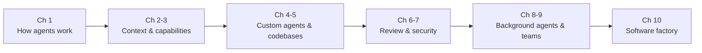

# Contents: From Coding Agents to the Software Factory

[中文](../zh/00-目录.md) | **English**

This book reorganizes the ten weeks of Stanford CS146S (The Modern Software Developer, Fall 2026) into one progressive path: first understand how a coding agent works, then give it context and capabilities, write requirements as specs, run the plan–build–evaluate loop, and finally automate the whole pipeline into a software factory. Each chapter covers one or two course weeks; guest lectures appear as "Guest sidebars" in the matching chapter.

Looking for a specific date? See the [Learning Path](../../LEARNING_PATH.en.md).

| Ch | Title | Course weeks | Status |
|---|---|---|---|
| 1 | How Coding Agents Work | Week 1 (9/22, 9/24) | Done |
| 2 | Context Engineering and Spec-Driven Development | Week 2 (9/29) | Rewriting |
| 3 | Tools and Capabilities: MCP and Skills | Week 2 (10/1), Week 3 (10/6, 10/8) | Rewriting |
| 4 | Customizing Your Agent | Week 4 (10/13, 10/15) | Rewriting |
| 5 | Agent-Ready Codebases | Week 5 (10/20, 10/22) | Rewriting |
| 6 | Agentic Code Review | Week 6 (10/27, 10/29) | Coming |
| 7 | Security in AI Codebases | Week 7 (11/3, 11/5) | Coming |
| 8 | Background Agents | Week 8 (11/10, 11/12) | Coming |
| 9 | Building an AI-Native Team | Week 9 (11/17, 11/19) | Coming |
| 10 | The Software Factory and the Future | Week 10 (12/1, 12/3) | Coming |

## Chapter 1 · How Coding Agents Work

- **Goals:** explain how the LLM, the harness and tools fit together; write a minimal "loop + tools" agent; understand why context determines code quality.
- **Lectures:** 9/22 intro + Claude Code in 200 lines; 9/24 anatomy of a modern coding agent; readings Building a Coding Agent, Lessons from Building Claude Code, Dive into Claude Code.
- **Practice:** Assignment 1, intercepting a real coding agent's traffic.

## Chapter 2 · Context Engineering and Spec-Driven Development

- **Goals:** advanced prompting; the cost of the context window and when to compact; writing a spec before letting the agent build (RePPIT and similar frameworks).
- **Lectures:** 9/29; readings The Context Tax, OpenSpec, Superpowers.

## Chapter 3 · Tools and Capabilities: MCP and Skills

- **Goals:** understand tool calling and the MCP protocol; write a skill; choose between MCP, a skill, and the plain CLI.
- **Lectures:** 10/1 MCP and tool calling; 10/6 Agent Skills; readings Enterprise MCP, pstack, Matt Pocock's Skills, browse.sh.
- **Guest sidebar:** Lee Robinson (10/8). Slides are marked confidential; public points only.

## Chapter 4 · Customizing Your Agent

- **Goals:** write good CLAUDE.md / AGENTS.md files; steer agents with hooks, rules and subagents.
- **Lectures:** 10/13; readings I Still Prefer MCP Over Skills, AGENTS.md, Steering Claude Code, Writing a Good CLAUDE.md.
- **Guest sidebar:** Boris Cherny (10/15, Claude Code). Awaiting official materials.

## Chapter 5 · Agent-Ready Codebases

- **Goals:** assess and improve a codebase's agent readiness: structure, docs, tests, checks.
- **Lectures:** 10/20; readings Making Codebases Agent Ready, Making Ergonomic Repositories.
- **Guest sidebar:** Eno Reyes (10/22, Factory). See the interview <https://youtu.be/pHGGlrKSnJ8>.

## Chapter 6 · Agentic Code Review (coming)

- **Planned:** best practices and architectures for agent code review, the "evaluate" step of the loop.
- **Lectures:** 10/27; guest sidebar Silas Alberti (10/29).

## Chapter 7 · Security in AI Codebases (coming)

- **Lectures:** 11/3; guest sidebar Isaac Evans (11/5).

## Chapter 8 · Background Agents (coming)

- **Planned:** dispatching tasks asynchronously so agents keep working in the background.
- **Lectures:** 11/10; guest sidebar Rajesh Bhatia (11/12).

## Chapter 9 · Building an AI-Native Team (coming)

- **Lectures:** guest sidebars Elad Gil (11/17) and Amjad Masad (11/19).

## Chapter 10 · The Software Factory and the Future (coming)

- **Planned:** coding agents in large teams; self-running, self-improving software systems.
- **Lectures:** 12/1, 12/3.
- **Final project:** an open-ended project applying the whole book.
