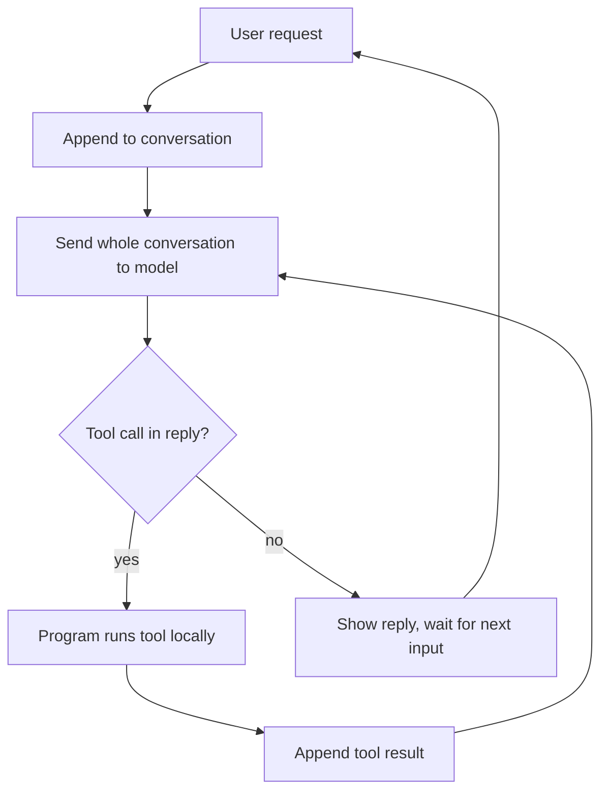

# Chapter 1 · How Coding Agents Work

[中文](../zh/01-编程代理是怎么工作的.md) | **English**

> Course mapping: Week 1, 9/22 "Intro + Claude Code in 200 lines" and 9/24 "Anatomy of a Modern Coding Agent". For notes by date, see the [Learning Path](../../LEARNING_PATH.en.md).

## Learning goals

After this chapter you should be able to:

1. Explain what a code-writing LLM can and cannot do on its own;
2. Explain why **agent = a loop + a set of tools**, and draw that loop;
3. Read a minimal ~200-line coding agent and know what each part does;
4. Name the parts a modern coding agent (such as Claude Code) adds on top, and the problem each one solves;
5. See why context engineering is the starting point for every later chapter.

## 1.1 Why start with principles

The course states its stance up front: it teaches principles, not tools. Popular coding agents change every few months, but the structure underneath barely changes. Once you understand that structure, you can size up any new tool quickly: what it is good at, where it is weak, and how to feed it.

> "This class is about principles not tools"
> 这门课讲的是原则，而不是工具。
> —— Lecture 1 slides (9/22)

The course also makes a claim about developers: AI has pushed developer productivity to an all-time high, so expectations have risen with it. What AI replaces easily is translating requirements into code; what it does not replace easily is understanding the business, designing systems, and judging code quality. The ten chapters of this book mostly train the second kind of skill, and step one is seeing through the tool in your hands.

## 1.2 Starting point: an LLM that writes code

Begin with the plainest case. An LLM is essentially a function: text in, continuation out. Code is text, so a well-trained model given a requirement produces plausible code.

It has three built-in limits:

- **It cannot see your project.** It knows only what you put in this one input: not your files, function names, or how tests run.
- **It cannot act.** It can only talk. It cannot read files, edit them, or run commands; you copy, paste, run and paste the error back.
- **It has no memory.** Each call is independent. A "conversation" is really the whole history resent every time.

"AI coding" in a chat window means you are the bridge for all three: you show it the project, act for it, and carry the context. A coding agent automates that bridge.

## 1.3 Letting the model act: tool calling

The first breakthrough is **tool calling**. Describe the available tools to the model (names, parameters, what they do) and agree on a format. When the model wants a file, it outputs a request in that format, for example:

```text
tool: read_file({"filename": "app.py"})
```

The model has not read anything. It only produced a line of text. Your program recognizes the line, reads the file locally, and sends the result back as new text.

So **tool calling is a text protocol**: the model says what to do, the program does it, and the result is said back. Today's APIs offer native tool-calling formats, but the principle is identical.

> [!NOTE]
> **Supplement**
> This is why the 9/24 lecture stresses that tool names, descriptions and signatures are part of the prompt. The model decides when and how to use a tool by reading that text; vague descriptions lead to misuse.

## 1.4 Letting the model keep working: the agent loop

One tool call is not enough. Fixing a bug means listing files, reading, editing, checking: a chain of actions. The second breakthrough is to put "call model → run tool → feed back result" inside a loop that runs until the model stops asking for tools.



This is the course's central sentence: **agent = a loop + a set of tools**. The program wrapping the model and running the loop is the **harness**. The model is the brain; the harness is body and nervous system, deciding what the model sees, what it can do, and how results come back.

Two details are easy to miss:

- **There are two loops.** The outer loop waits for the user; the inner loop is the agent working on its own, possibly a dozen tool calls in a row.
- **The conversation only grows.** Every tool result is appended and the whole thing is resent. The longer the agent works, the longer the input. This becomes a real problem in 1.7.

## 1.5 Hands-on: a ~200-line coding agent

The 9/22 lecture built a minimal coding agent live, about 200 lines of Python. The course's sample code has no open-source license, so it is not reproduced here; below is our own explanatory version with the same structure, error handling omitted.

**Step 1: three tools.** Reading, listing and editing files already covers a surprising amount of work.

```python
def read_file(filename):
    """Return the full contents of a file"""
    return {"path": filename, "content": open(filename).read()}

def list_files(path="."):
    """List files and subdirectories"""
    return [{"name": n, "type": "dir" if os.path.isdir(n) else "file"}
            for n in os.listdir(path)]

def edit_file(path, old_str, new_str):
    """Replace the first old_str with new_str; empty old_str creates the file"""
    if old_str == "":
        open(path, "w").write(new_str); return "created"
    text = open(path).read()
    if old_str not in text:
        return "error: old_str not found"   # tell the model instead of crashing
    open(path, "w").write(text.replace(old_str, new_str, 1))
    return "ok"

TOOLS = {"read_file": read_file, "list_files": list_files, "edit_file": edit_file}
```

`edit_file` uses exact string replacement: the model must have read the file to name the exact text to replace. Simple, yet the same idea as editing tools in mature products. Returning an error instead of raising lets the model reread and retry, which is where an agent's "self-correction" comes from.

**Step 2: put tool descriptions in the system prompt,** generated from names, docstrings and signatures:

```python
def describe_tools():
    return "\n".join(f"- {name}{inspect.signature(fn)}: {fn.__doc__}"
                     for name, fn in TOOLS.items())

SYSTEM_PROMPT = f"""You are a coding assistant with these tools:
{describe_tools()}
To call a tool, output a single line: tool: name({{JSON args}})
After a tool_result, continue the task; answer directly if no tool is needed."""
```

**Step 3: parse tool calls** by scanning lines that start with `tool:`, splitting the name and JSON arguments, skipping malformed lines.

**Step 4: the main loop.**

```python
messages = [{"role": "system", "content": SYSTEM_PROMPT}]
while True:                                   # outer: wait for the user
    messages.append({"role": "user", "content": input("> ")})
    while True:                               # inner: agent works on its own
        reply = call_llm(messages)
        messages.append({"role": "assistant", "content": reply})
        calls = parse_tool_calls(reply)
        if not calls:
            print(reply); break               # no more tools, hand back
        for name, args in calls:
            result = TOOLS[name](**args)
            messages.append({"role": "user",
                             "content": f"tool_result({json.dumps(result)})"})
```

That is all. Ask it to "create hello.py that prints hello" and you will watch it list the directory, create the file, and report back. The slides sum up the moment in three words: "It's that simple".

> [!NOTE]
> **Supplement**
> Tool results go back in the `user` role here, matching what the 9/24 lecture showed when intercepting a real product: to the model, a tool result is just another message.

## 1.6 From toy to product: what modern agents add

If 200 lines work, what is all the extra code in products like Claude Code for? The 9/24 lecture took this apart:

> "Harness design is one of the most important problems in coding agents"
> 框架设计是编程代理中最重要的问题之一。
> —— Lecture 2 slides (9/24)

Modern harnesses add these parts on top of "loop + tools", best understood by the problem each solves:

| Part | Problem it solves | Always in context or on demand |
|---|---|---|
| System prompt | Behavior, guardrails, environment; the agent's blueprint | Always |
| Config files (CLAUDE.md, AGENTS.md) | Project conventions written by the user, high priority | Always |
| Tool list | Broader abilities: search, shell, subtasks; mature products ship ~40 built-in tools, plus MCP tools | Always |
| Plan mode | Write a spec for the change first; ask the user when unclear | On demand |
| Skills | A packaged written procedure, loaded only when used | On demand |
| Subagents | A fresh context for a subtask, returning only the result; can run in parallel | On demand |
| Hooks | Checks or processing at fixed lifecycle points, e.g. format after every edit | On demand |
| Compaction | Summarize history when context is nearly full; lossy | On demand |

The last column reveals the thread: **almost every part manages one thing, what the model can see right now**. What must always be there, what to fetch when needed, what to drop afterwards: that is the heart of harness design. The lecture's three principles follow: few, powerful tools; watch the context window; prompts keep changing, so keep them easy to edit.

## 1.7 Where this leads: context engineering

Back to the detail from 1.4: the conversation only grows. Two consequences:

- **Cost and latency.** The full history is resent every turn.
- **The model gets worse.** Overfull context makes the model lose focus; the course calls this the "dumb zone". Too many tool descriptions (tool bloat) also eat space.

Conversely, precise and sufficient context visibly improves the code. The course puts this in the first lecture's takeaways:

- Good context leads to good code;
- If you can't understand your codebase, neither will an LLM;
- Don't settle for low-quality output that merely seems to work (AI slop).

The craft of deciding what the model sees at each step is **context engineering**. It is not a trick of one tool but the basic skill of working with agents. Chapters 2–5 all answer one question from different angles: how to give the agent exactly the context it needs.

> [!NOTE]
> **Supplement**
> A practical test: imagine handing the task to a smart colleague on their first day. What would they need to know? That belongs in the context; anything else just adds noise.

## Related videos

- [Building a Coding Agent](https://youtube.com/watch?v=s7ZzkdvCMDY): this week's official reading, building a coding agent in ~200 lines. The channel, The Modern Software Developer, shares the course name and is likely the instructor's (unconfirmed).
- [CS146S weekly recap playlist](https://www.youtube.com/playlist?list=PLxpwjSdVZQ97L8hAGqTYUeOJqnKVSu3pb): fan-made by AI With Ryan, unofficial, summarizing the Fall 2025 run; not lecture recordings. Good as a preview.
- Further reading: [Lessons from Building Claude Code](https://x.com/trq212/status/2027463795355095314), [Dive into Claude Code (paper)](https://arxiv.org/pdf/2604.14228).

## Practice

This week's assignment is to intercept the requests and responses between a real coding agent and its model with a proxy, the way you would with Wireshark or browser dev tools. Suggested order:

1. Complete the explanatory version from 1.5 and run it; have it create and edit hello.py;
2. Add a `run_command` tool allowing only whitelisted commands such as `ls` and `python`; see whether it runs code to verify its work;
3. Do the assignment: capture one real request, locate the system prompt, the tool list and the fed-back tool results, and map each to the table in 1.6;
4. Note the rough size of one full request and decide which parts are always present and which are needed only this turn.

The public 2025 assignments repo: <https://github.com/mihail911/modern-software-dev-assignments> (linked only).

## Self-check

- [ ] I can name the LLM's three limits and how an agent addresses each
- [ ] I can draw the agent loop from memory, with both loops
- [ ] I can explain why tool calling is a text protocol
- [ ] I can say why `edit_file` returns an error instead of raising
- [ ] I can name the 8 harness parts and whether each is always loaded or on demand
- [ ] I can explain context engineering in one sentence, and why a full context makes the model worse

## Next chapter

You now know an agent is largely as good as what it sees at each step. So how exactly should prompts be written? When should context be compacted? Instead of letting the agent guess as it goes, can you first write the requirement as a clear spec? Chapter 2, "Context Engineering and Spec-Driven Development", starts there.
