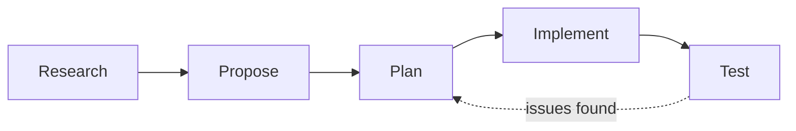

# Chapter 2 · Context Engineering and Spec-Driven Development

[中文](../zh/02-上下文工程与规格驱动开发.md) | **English**

## Original materials covered

| Type | Date / speaker | Topic | Official links |
|---|---|---|---|
| Lecture | 9/29 · Mihail Eric | Advanced prompting and context engineering in complex codebases (RePPIT) | [Slides](https://docs.google.com/presentation/d/17brqoQQZHF3K82WgYaV6urAV3Q7iIwyGUBYRvSuY8QY/edit) · [Transcript](https://themodernsoftware.dev/materials/9-29-26-transcript.txt) |
| Reading | — | The Context Tax: When to Compact | [LangWatch](https://langwatch.ai/blog/context-tax-when-to-compact) |
| Reading | — | OpenSpec | [openspec.dev](https://openspec.dev) |
| Reading | — | Superpowers | [GitHub](https://github.com/obra/superpowers) |
| Weekly notes | Week 2 | Notes in slide order | [Appendix: Week 2 notes](../../weeks/week02/en/notes.md) |

## Learning goals

1. Explain the difference between ad-hoc prompting and methodical agent use, and why production code needs the latter;
2. Know the five RePPIT stages (Research, Propose, Plan, Implement, Test) and what each produces;
3. Understand "smart tokens" versus the "dumb zone", and judge when to clear or compact;
4. Pick a delegation style by task size: simple prompt, plan first, research then plan, or several rounds;
5. Know where specs should live and how to manage them.

## 2.1 Picking up from Chapter 1

Chapter 1 concluded that an agent is as good as what it sees at each step. The next question is: **who decides what it sees?** If you just say "add this feature", the agent decides: it guesses, reads files as it goes, and starts writing from scraps. Fine for small changes; once the codebase and feature grow, results become unpredictable.

The 9/29 lecture's goal is to upgrade ad-hoc prompting into a robust, repeatable synchronous workflow: work out the problem with the agent, write the conclusions down, then build.

## 2.2 What vibe coding can't solve

"Vibe coding" has many definitions; the common one is pressing Tab, accepting everything, and shipping whatever runs. Good for prototypes, but the course says plainly it is not the focus. The lecture asks: how would you build a clone of a budgeting app and scale it to production? Accepting everything won't do; you must use agents methodically.

The instructor's bar:

> "You should have an active, functional mental model of how you would build your solution"
> 你应该对自己会怎么搭建这个方案，有一个活跃的、能运转的心智模型。
> —— Lecture 3 slides (9/29)

This doesn't mean writing the code yourself. It means holding the whole solution in your head: which modules change, how data flows, where the risks are. The agent executes; you judge. The slides name two kinds of bad code today: **wrong architectural decisions** and **functionally incorrect software** (often from hallucination). The first is prevented by thinking ahead, the second caught by verifying afterwards; the workflow below addresses both.

## 2.3 RePPIT: think first, then build

RePPIT names five stages, each producing a document you can save and review:



**Research.** Have the agent turn the relevant code into a structured research document: modules, organization, where the key code is. The point is a document, not dumping raw code into context. It seeds the later steps and helps you build your own mental model.

**Propose.** From the research, have the agent offer about two options and compare trade-offs. The instructor finds more than two has diminishing returns.

**Plan.** Turn the chosen option into a detailed plan: files to change, testing, logging or monitoring, and **explicitly what is out of scope**. That last part stops the agent from "helpfully" changing things you didn't ask for.

**Implement.** The agent writes code per the plan. Interestingly, this prompt is the simplest, because the hard part is done.

**Test.** Unit, integration and smoke tests; optionally a review skill that checks architecture, style and consistency. When tests fail, go back to the plan rather than patching code.

The demo added a "spending by category over time" trend line to the budgeting app. After research and proposals, the instructor chose a frontend-only option. RePPIT's value is not just correctness; it helps you find the **smaller** change.

> [!NOTE]
> **Supplement**
> The slides note you should iterate on this workflow yourself. RePPIT is a starting point, not dogma: small tasks don't need all five steps; large ones may need several rounds.

## 2.4 The context window: smart tokens and the dumb zone

Why write research down instead of keeping one long conversation? Because a fuller window is not better. The slides give a rule of thumb: only the first **half to three quarters** of the context window holds "smart" tokens. The system prompt, AGENTS.md / CLAUDE.md and task context fill that space in turn; beyond it lies Chapter 1's "dumb zone".

Practical habits follow:

- **Turn each finished step into an artifact.** Research, proposals and plans are clean context for a fresh session.
- **Clear rejected options.** Left in the conversation they waste tokens and can mislead implementation. Start fresh or compact.
- **Use the strongest model for thinking, a lighter one for doing.** Research, proposals and plans need judgment; implementation and tests follow the plan.
- **Maintain docs or drop them.** Stale docs are worse than none; the agent will believe them.

On when to compact, the reading The Context Tax weighs cost against quality; the lecture cites roughly 250k–450k tokens as a reasonable point, varying by model. The habit matters more than the number: always know what is in your context.

## 2.5 Matching method to task

Not every task deserves the full process. The slides list four delegation styles, from light to heavy:

| Style | Fits | Example |
|---|---|---|
| Simple prompt | Small, clear, errors easy to spot | Change copy, fix a typo |
| Make a plan | A few files, code you know | Add a parameter to an endpoint |
| Research then plan | Unfamiliar code or unclear impact | New feature in a new project |
| (Research then plan) × N | Large features split into subtasks | Refactor a module, a migration |

For big features: split into a task list, write each finished item up as a document, and start the next item from it. Each item runs in clean context.

## 2.6 Worked example: a plan that is good enough

Here is our own plan template, structured per RePPIT. The format matters less than how each section forces one question to be answered:

```markdown
# Plan: spending trend chart (frontend only)

## Background
See research.md §2: transactions already come back by category and date; no backend change.

## Chosen option
Option A (aggregate in frontend). Rejected B (new endpoint): small data, B touches more code.

## Files
- src/charts/TrendChart.tsx (new)
- src/pages/Dashboard.tsx (mount chart)

## Tests
- Unit: monthly aggregation, empty data, year boundary
- Smoke: open dashboard locally, chart shows 3 categories

## Out of scope
- No API or database changes
- No restyling of existing charts
```

Hand this to the agent and the prompt shrinks to: "Implement plan.md, then run the tests."

## 2.7 Other spec-driven frameworks

RePPIT is not the only approach. This week's readings cover two popular frameworks:

- **Superpowers**: an opinionated, end-to-end guided workflow based on TDD, built from skills for specs and plans, implementation and testing, with built-in parallelism.
- **OpenSpec**: lighter. It keeps specs in the repo as the source of truth; each change gets a change spec that is merged back after implementation.

Where should specs live? In a tracker like Linear, or locally in Git as OpenSpec does. The lecture also suggests recording design trade-offs and decisions per area of the codebase in a `.notes/` directory, so future agents and people can find them.

> [!NOTE]
> **Supplement**
> Specs in Git get reviewed and reverted together with code. In Chapter 6, reviewers can check a change against its spec to see if it overstepped.

## Related videos

- [CS146S weekly recap playlist](https://www.youtube.com/playlist?list=PLxpwjSdVZQ97L8hAGqTYUeOJqnKVSu3pb): fan-made by AI With Ryan, unofficial, summarizing Fall 2025; good as a preview.
- 9/29 lecture recording: not published.

## Practice

1. Pick a small feature in your own project that touches two or three files;
2. Run RePPIT and save research.md, proposal.md and plan.md;
3. Implement in a fresh session, giving the agent only plan.md; can it finish on its own?
4. Reflect: which document helped most? Which step could you skip?

## Self-check

- [ ] I can name the five RePPIT stages and their outputs
- [ ] I can explain why a plan should list what is out of scope
- [ ] I know roughly what share of the window is "smart" and what happens beyond it
- [ ] I can give a fitting task for each of the four delegation styles
- [ ] I can describe Superpowers and OpenSpec

## Next chapter

So far the agent's tools are just file read/write. Real development also means docs, tickets, databases and browsers. How do you connect those capabilities without flooding the context with tool descriptions? Chapter 3, "Tools and Capabilities: MCP and Skills".
