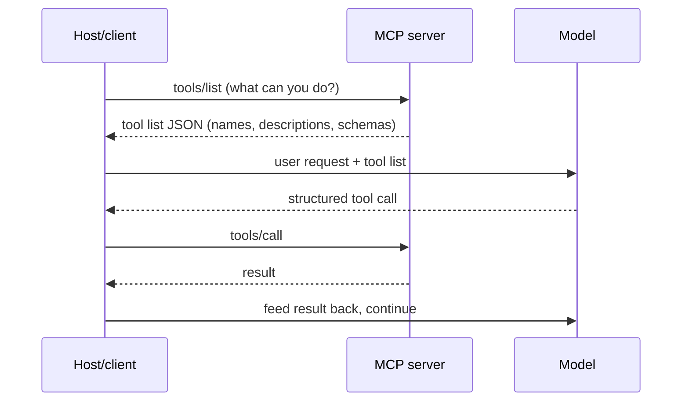

# Chapter 3 · Tools and Capabilities: MCP and Skills

[中文](../zh/03-工具与能力-MCP和Skills.md) | **English**

## Original materials covered

| Type | Date / speaker | Topic | Official links |
|---|---|---|---|
| Lecture | 10/1 · Mihail Eric | MCP, tool calling and beyond | [Slides](https://docs.google.com/presentation/d/1q2cB1a7P4XsR0UJqE0RmtZFeggNOLdPaSnOpbBVewHA/edit) · [Transcript](https://themodernsoftware.dev/materials/10-1-26-transcript.txt) · [Skills folder](https://drive.google.com/drive/folders/1aEHCXzZKkokuA4AYjD_2i6OrcM5iQosW) |
| Lecture | 10/6 · Mihail Eric | Agent Skills | [Slides](https://docs.google.com/presentation/d/15bPu5c-i8D8McTh6l7SpUPk2n9M_Y-CdDQLfyzL8RD8/edit) |
| Guest | 10/8 · Lee Robinson | How always-on agents work | [Slides](https://drive.google.com/file/d/1b8WiBk_lcB3ue-jZMLijSUMLj6SDiF6Z/view) (marked confidential; public points only) |
| Reading | — | Enterprise MCP (Cloudflare) | [Cloudflare blog](https://blog.cloudflare.com/enterprise-mcp) |
| Reading | — | pstack · Matt Pocock's Skills · browse.sh | [pstack](https://github.com/cursor/plugins/tree/main/pstack) · [skills](https://github.com/mattpocock/skills) · [browse.sh](https://browse.sh) |
| Standards | — | MCP spec · Agent Skills standard | [modelcontextprotocol.io](https://modelcontextprotocol.io) · [agentskills.io](https://agentskills.io/home) |
| Weekly notes | Weeks 2, 3 | Notes | [Week 2](../../weeks/week02/en/notes.md) · [Week 3](../../weeks/week03/en/notes.md) |

## Learning goals

1. Explain why agents need dynamic data and what problem MCP solves;
2. Name MCP's four roles (host, client, server, tool) and walk through one call;
3. Design a good MCP server: outcome-oriented, explicit parameters, descriptions as prompts;
4. Understand what a skill is, why it loads on demand, and write a decent one;
5. Choose between an API, MCP, a skill and the CLI.

## 3.1 The model knows a lot, all of it old

LLMs hold vast world knowledge, but it is **static**: frozen at the training cutoff, updated only by retraining. What development actually needs is dynamic: today's tickets, a fresh production error, the latest rows in the database, docs for a library version released last week.

Chapter 1 already has the answer: tools. Whatever the agent needs, give it a tool to fetch it. The problem is scale. With M agent products (Cursor, Claude Code…) and N services (GitHub, Jira, Notion…), a connector per pair means M × N connectors, each handling auth, errors and rate limits. That doesn't scale.

## 3.2 MCP: one plug for every tool

**MCP (Model Context Protocol)** is an open protocol that lets systems provide context to AI models in a format shared across integrations. The slides put it more bluntly:

> "In English: standard format for exposing tools to LLMs"
> 说白了：向大模型暴露工具的标准格式。
> —— Lecture 4 slides (10/1)

With a shared format, each agent implements one MCP client and each service ships one MCP server: M × N connectors become M + N. Messages use JSON-RPC; transports are local stdio and remote streamable HTTP.

MCP has four roles:

| Role | What it is | Example |
|---|---|---|
| Host | The agent app the user uses | Cursor, Claude Desktop |
| Client | Library inside the host; one stateful session per server | — |
| Server | Thin wrapper in front of a service | GitHub MCP, Notion MCP |
| Tool | A callable function the server offers | `create_issue`, `search_pages` |

A full call:



Compare with Chapter 1: it is the same agent loop, except the tools are no longer three hard-coded functions but fetched dynamically from any MCP server.

## 3.3 A good MCP server is not an API mirror

The most common mistake is wrapping every REST endpoint one-to-one as a tool. The lecture explains why not: endpoints are designed for human programmers, not necessarily for how models consume information. One-to-one mapping leads to too many small tools, bloated and messy context, and agents spending their steps orchestrating call order.

Best practices from the slides:

- **Design for outcomes, not operations.** Offer `send_payment(user_email)`, not `get_users` → `list_account` → `send_payment(account_id)`.
- **Explicit parameters.** Avoid nested dicts as input; models fill them wrongly.
- **Instructions are context.** Docstrings and error messages are prompts; make them clear so the model uses tools correctly and recovers from errors, as with Chapter 1's `edit_file`.
- **Discoverable names.** Prefix tools with the service, e.g. `linear_create_issue`, so multiple servers don't collide.

When servers number in the dozens, a more radical design exposes just two tools, **search** and **execute**. The agent searches for the tool definitions it needs, then execute runs deterministic code to do the work. Context no longer grows with the number of servers; the slides cite over 90% token reduction. Their example: find a Jira ticket and update it with information from Google Drive. Complex cross-service logic runs in one step of code, and data is filtered before it reaches the model.

> [!NOTE]
> **Supplement**
> Enterprises also need control. In this week's Cloudflare reading, employees connect only to an MCP portal, which lists the internal and third-party servers they may use and centralizes logging, policy and data-loss protection.

## 3.4 Skills: a manual written for agents

MCP covers what the agent can do, but not how something should be done: what your team checks in review, what runs before a release, how technical docs are structured. Those are **procedures**, not tools.

LLMs happen to be very good at following long written procedures. **Agent Skills** standardize that: a skill is a folder centered on a Markdown procedure, optionally with scripts and reference files. The slides call them "like scripts for agents".

The key design is **on-demand loading**: at session start the agent sees only each skill's name and one-line description; it reads the full content only when a skill looks relevant. A hundred skills won't flood the context, the same always-on versus on-demand split as Chapter 1's table.

A skill skeleton (our own example):

```markdown
---
name: release-check
description: Pre-release checks. Use when the user says "prepare a release", "tag", or "release".
---
1. Run `npm test`; stop and report on failures.
2. Run `npm run lint` and auto-fix what it can.
3. Check CHANGELOG.md has an entry for this version; if not, draft one for the user to confirm.
4. List commits since the last tag, grouped into features and fixes.
Versioning rules are in references/versioning.md (read only when needed).
```

The last line keeps details in a separate file read on demand: **progressive disclosure**.

## 3.5 Eight lessons for writing skills

The 10/6 slides list best practices that fall into three groups:

**Scope and sources.** One skill, one well-defined task. The best source is your own conversation history: wherever you repeatedly corrected the agent, write the correction down as a skill. Keep a personal skill collection you carry between projects.

> "Chefs bring their own knives between kitchens"
> 厨师换厨房，也带着自己的刀。
> —— Lecture 5 slides (10/6, quoting poteto)

**Triggers and structure.** State the situations and phrasings that should trigger the skill so the agent knows when to use it; use progressive disclosure to control length; keep skills modular and composable.

**Saving effort and closing the loop.** If an existing CLI does the job, give the agent the CLI and wrap boilerplate in a skill rather than letting it reinvent the wheel. Keep a **verification skill** so the agent checks its own output.

The slides also group skills: code understanding and planning (the RePPIT series, grill-me which makes the agent question you about requirements), verification, code style (good for review agents), and others such as web parsing.

## 3.6 Choosing between API, MCP, skill and CLI

| | API | MCP | Skill |
|---|---|---|---|
| What | Service interface for developers | Tool definitions exposed to agents in a standard way | Packaged procedure teaching an agent a job |
| Used by | You or an SDK | The agent runtime | The agent, as a higher-level capability |
| Solves | Program-to-program communication | Agent access to external services and data | Repeatable ways of working |

A simple order of thought: external systems with auth and permissions → MCP; a mature local CLI → let the agent use the CLI; fixed steps → a skill, which can call MCP or the CLI. Chapter 4's readings include a counterpoint, "I Still Prefer MCP Over Skills".

## Guest sidebar: Lee Robinson, how always-on agents work (10/8)

> [!NOTE]
> **Supplement**
> The slides for this talk are marked confidential with forward-looking statements, so this is our own summary of the ideas, with no quotes.
>
> Chapter 1's agent stops when you close the terminal. An always-on agent runs on a server with its own cloud computer, keeps state, memory and skills, wakes on events (your messages, schedules, mentions in chat tools) and can keep working for a long time.
>
> Human–AI collaboration is evolving: from copy-pasting chats, to approving each step in a terminal, to many agents working in the background while you review results, to messaging a "colleague" with its own computer and memory. Your role shifts from approving each step to steering.
>
> Most relevant here: memory and skills are plain-text files that people and agents can read and edit, and skills load only when needed, so many are cheap. Architecturally, state lives on the server and every step can be retried safely. Chapter 8, "Background Agents", expands on this.

## Related videos

- [CS146S weekly recap playlist](https://www.youtube.com/playlist?list=PLxpwjSdVZQ97L8hAGqTYUeOJqnKVSu3pb): fan-made, unofficial, Fall 2025 summaries.
- 10/1, 10/6, 10/8 recordings: not published.

## Practice

1. Write a small MCP server with 2–3 outcome-oriented tools (e.g. check the weather and suggest what to wear) and connect it to your agent;
2. Find a place in last week's agent conversations where you kept correcting it, and write it up as a skill;
3. Give the skill clear trigger phrasings and test in a fresh session whether the agent picks it up on its own;
4. Compare doing one job via MCP, CLI and a skill: context cost and reliability.

## Self-check

- [ ] I can explain M × N versus M + N
- [ ] I can draw one MCP call
- [ ] I can say why REST endpoints shouldn't map one-to-one to MCP tools
- [ ] I can explain why search + execute saves tokens
- [ ] I can describe on-demand skill loading and progressive disclosure
- [ ] Given a need, I can pick MCP, CLI or a skill

## Next chapter

Tools and procedures are in place, but one thing is missing: the agent's knowledge of **your project**. Build tools, code style, what not to touch: these need to be written down and kept in context. Chapter 4, "Customizing Your Agent", covers AGENTS.md, hooks and subagents.
