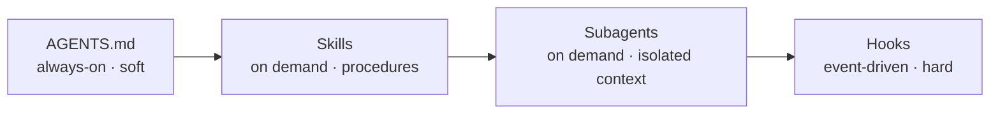
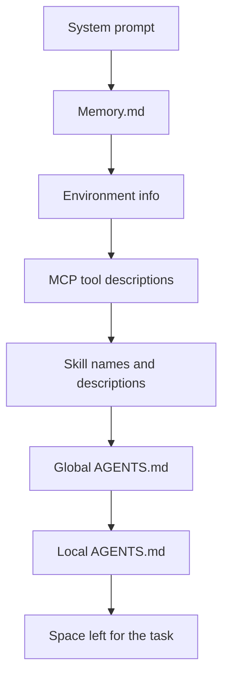

# Chapter 4 · Customizing Your Agent

[中文](../zh/04-定制你的代理.md) | **English**

## Original materials covered

| Type | Date / speaker | Topic | Official links |
|---|---|---|---|
| Lecture | 10/13 · Mihail Eric | Customizing your agent setup | [Slides](https://docs.google.com/presentation/d/152VaUifBKH4T6hxd6fCKKM9kJTSAuBmkF8zSYwuTYAo/edit) |
| Guest | 10/15 · Boris Cherny (Claude Code) | Guest lecture | No materials published yet |
| Class example | — | Next.js AGENTS.md | [GitHub](https://github.com/vercel/next.js/blob/canary/AGENTS.md) |
| Reading | — | I Still Prefer MCP Over Skills | [david.coffee](https://david.coffee/i-still-prefer-mcp-over-skills) |
| Reading | — | AGENTS.md (Factory docs) | [Factory](https://docs.factory.com/harness/agents-md) |
| Reading | — | Steering Claude Code | [claude.com](https://claude.com/resources/articles/steering-claude-code-skills-hooks-rules-subagents-and-more) |
| Reading | — | Writing a Good CLAUDE.md | [hlyr.dev](https://hlyr.dev/blog/writing-a-good-claude-md) |
| Weekly notes | Week 4 | Notes | [Appendix: Week 4 notes](../../weeks/week04/en/notes.md) |

## Learning goals

1. Name the four main customization tools (config files, hooks, skills, subagents) and what each is for;
2. Write a well-structured AGENTS.md / CLAUDE.md under 300 lines;
3. Understand that hooks are deterministic and when they beat prompts;
4. Use subagents to keep side tasks out of the main context;
5. Draw the layers of a session's context and judge its budget.

## 4.1 Why customize

Chapters 1–3 covered general abilities: loop, tools, procedures. But every project has quirks: this one uses maven not gradle, that one's tests need a flag, some directory is generated and must never be hand-edited. The model can't know these in advance, and reminding it every session is tiring and error-prone.

The slides' framing: to get the most out of coding agents, **own your stack**. Modern harnesses offer many levers; this chapter goes from always-on to on-demand, from soft to hard constraints.



## 4.2 AGENTS.md: a README for agents

> "README for agent"
> 写给代理看的 README。
> —— Lecture 7 slides (10/13)

AGENTS.md (CLAUDE.md in Claude Code, same idea) lives in the repo, loads into context at the start of every session, and carries high priority. The slides suggest six parts:

1. **Project overview**: a map of the codebase;
2. **Build and test commands**: e.g. "use maven, not gradle";
3. **Code style**;
4. **Testing instructions**;
5. **Security considerations**;
6. **Stack-specific gotchas**: e.g. "React 18 + TypeScript, built with Vite".

The writing principles matter more than the structure:

- **Universally applicable.** Only what every session needs. Feature-specific notes belong in a skill or a subdirectory doc.
- **Avoid code snippets.** Code goes stale fast, and stale examples mislead, the same lesson as Chapter 2's stale docs.
- **Mind the length.** Under 300 lines. It is always-on context; each line eats smart tokens.
- **Nest in large repos.** The root file acts as a router: "for API gateway details, see docs/API-GATEWAY.md".

CLAUDE.md files load from the root down to the one nearest the current file, so the most specific instructions are read last, letting different services or teams keep their own conventions. The lecture used the Next.js AGENTS.md as a real example; worth reading.

A compact example of our own:

```markdown
# AGENTS.md
## Map
- web/: frontend (React 18 + TypeScript, Vite)
- api/: backend (FastAPI)
- docs/: design docs; read docs/ARCHITECTURE.md before changing architecture

## Commands
- setup: make setup   test: make test   format: make fmt

## Conventions
- New endpoints need unit tests
- Never hand-edit api/generated/; it is produced by make gen

## Security
- Never commit .env; read secrets from environment variables only
```

## 4.3 Hooks: code as the safety net

AGENTS.md is something the model reads; it usually complies, but not always. When something must happen every time, use **hooks**.

A hook is a **deterministic script** run on a fixed event:

| Event | When | Typical use |
|---|---|---|
| `UserPromptSubmit` | User submits a prompt | Sanitize or enrich the prompt |
| `PreToolUse` | Before a tool runs | Block dangerous commands, protect files |
| `PostToolUse` | After a tool runs | Run formatter or linter after edits |
| `PreCompact` | Before compaction | Save key information first |

The difference: a prompt says "please do this"; a hook says "this will happen". If you want formatting after every edit, AGENTS.md may be forgotten; a `PostToolUse` hook never is. Claude Code and Cursor both support hooks.

> [!NOTE]
> **Supplement**
> A rule of thumb: if breaking a rule would make you angry, don't leave it in a prompt; make it a hook or a CI check.

## 4.4 Skills and subagents: on-demand abilities, isolated context

**Skills** were covered in Chapter 3. In customization terms, they turn your frequent prompts into files: run tests, write plans, research, review, verify. Class examples were Claude Code's "ship-it" command and Cursor's "deslop" command.

**Subagents** solve a different problem: context pollution. Mid-feature, you need to understand an unfamiliar module. Exploring in the main conversation leaves all that code in context. Better to send a subagent: it works in a fresh context and returns only a conclusion.

A subagent's name, description and tool list load at session start; the agent can call it implicitly or you can call it explicitly. The slides list exploring the codebase, simplifying code after changes, and end-to-end testing as typical uses. They are **ideal for side quests**.

Compared with AGENTS.md: AGENTS.md anchors overall behavior; subagents outsource a kind of work so it doesn't muddy the main thread.

## 4.5 MCP as a customization tool

Chapter 3 explained MCP; this lecture adds its customization perks: seamless auth, easy versioning and updates, portability across clients, and natural sandboxing for remote servers. The slides list common MCPs by scenario:

| Type | Examples | Use |
|---|---|---|
| Project management | Jira, Linear | Pull tickets and start work; create and update issues |
| Docs | Notion, Confluence | Create issues from feature specs |
| Observability | Datadog, Sentry | Debug production issues live |
| Database | Redshift | Debug data issues, learn the schema |
| Technical docs | Context7 | Current library docs, fewer hallucinations |
| Experiment tracking | Arize | Suggest experiments from test results |

## 4.6 Stacking it all up: the context story

Putting this chapter and the earlier ones together, a session's context stacks roughly in this order:



Each layer shrinks the space left for the task. Recall Chapter 2: only the first half to three quarters is smart. So the goal of customization is not to write everything in, but to **get the most effect from the least always-on content**, leaving the rest to on-demand loading.

## Guest sidebar: Boris Cherny (10/15)

> [!NOTE]
> **Supplement**
> Boris Cherny is one of the creators of Claude Code. No slides or transcript have been published for this talk; we'll add notes when they are. The 10/13 slides cite hook examples he shared on X, a good place to start.

## Related videos

- [CS146S weekly recap playlist](https://www.youtube.com/playlist?list=PLxpwjSdVZQ97L8hAGqTYUeOJqnKVSu3pb): fan-made, unofficial, Fall 2025 summaries.
- 10/13, 10/15 recordings: not published.

## Practice

1. Rewrite your project's AGENTS.md or CLAUDE.md with the six-part structure in 4.2, under 300 lines;
2. Add a `PostToolUse` hook that runs your formatter or tests after each edit;
3. Add a `PreToolUse` hook that blocks edits to `.env` or generated directories;
4. Try a subagent split: one explores and summarizes the codebase, the main agent implements from the summary. Compare main-context length.

## Self-check

- [ ] I can name AGENTS.md's six parts and four writing principles
- [ ] I can explain why code snippets don't belong in AGENTS.md
- [ ] I can state the core difference between a prompt and a hook
- [ ] I can name two side tasks suited to subagents
- [ ] I can draw the context layers and explain why always-on content must stay small

## Next chapter

So far we have tuned the agent's side: tools, procedures, project notes. The other side is the codebase itself. With patchy tests, flaky builds and stale docs, even the best agent stumbles. Chapter 5, "Agent-Ready Codebases", starts from the repo.
