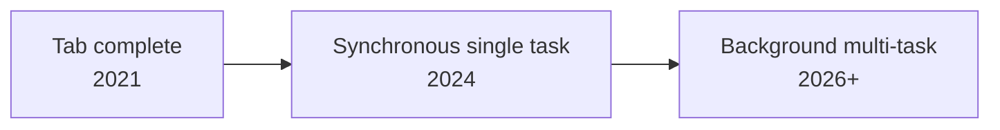

# Chapter 5 · Agent-Ready Codebases

[中文](../zh/05-让代码库适合代理.md) | **English**

## Original materials covered

| Type | Date / speaker | Topic | Official links |
|---|---|---|---|
| Lecture | 10/20 · Mihail Eric | Creating agent-ready repositories; background coding agent workflows | [Slides](https://docs.google.com/presentation/d/1yCxocmUrGIN7IrC42WB6NW08PtYYFLe1ombDj3Ay6_8/edit) |
| Guest | 10/22 · Eno Reyes (Factory CTO) | Guest lecture | No materials published yet; see the public interview in the sidebar |
| Reading | — | Making Codebases Agent Ready (video) | [YouTube](https://www.youtube.com/watch?v=ShuJ_CN6zr4) |
| Reading | — | Making Ergonomic Repositories | [X](https://x.com/trybasis/status/2056881705269580023) |
| Class demo | — | Factory Agent Readiness | [Intro](https://factory.ai/news/agent-readiness) · [Public reports](https://factory.ai/agent-readiness) · [Open-source alternative kodustech/agent-readiness](https://github.com/kodustech/agent-readiness) |
| Weekly notes | Week 5 | Notes | [Appendix: Week 5 notes](../../weeks/week05/en/notes.md) |

## Learning goals

1. Understand why many agent "mistakes" are environment problems, not model problems;
2. Name repo defects humans can work around but that break agents;
3. Use an agent-readiness checklist to score your own repo;
4. Know what readiness unlocks: big tasks, automated review, background agents;
5. Know how to isolate environments when running several agents in parallel.

## 5.1 Turning around: the problem may be the repo

Chapters 1–4 tuned the agent. The 10/20 lecture opens by recapping Chapter 4's context layers (system prompt, memory, environment, MCP, skills, two levels of AGENTS.md), then turns: most codebases today aren't set up for agent success, and much LLM confusion comes from trying to finish a task in a messy or incomplete developer environment.

Factory's article on the topic is blunt: teams blame the model, switch agents, get the same result; the real problem is usually the codebase. Without pre-commit checks, the agent waits ten minutes for CI to learn about a formatting error it could have caught in five seconds; with undocumented environment variables, it guesses, fails, and guesses again.

So the goal of this chapter: **optimize the codebase and environment so that both a human and an agent can understand what's going on**.

## 5.2 What humans work around, agents can't

The slides make an illuminating comparison. The same defects that humans route around stop agents cold:

| Repo defect | How humans cope | What happens to agents |
|---|---|---|
| Insufficient tests | Test manually | Can't verify correctness |
| Outdated docs | Ask teammates | Can't ensure consistency; acts on wrong info |
| No linter | Watch for semicolons | Style drift, rework |
| Flaky build | Retry | Can't verify changes |
| Complex setup | Ask teammates | No reproducible environment |
| Poor observability | Dig through logs | Can't debug |
| No security scanning | Ignore for now | Introduces vulnerabilities |
| Inconsistent patterns | Tribal knowledge | Learns and copies the wrong pattern |

The last row deserves a word. The lecture notes that "messy" can be as simple as several ways to access the database, inconsistent naming, or multiple functions doing the same thing. A human knows "new code uses pattern A" because a colleague said so; the agent sees A, B and C in the repo, picks one at random, or invents a fourth.

This table extends Chapter 1's thread: an agent's ceiling is what it can see and verify. Humans have tacit knowledge and colleagues; agents have only what is written in the repo and commands that produce results.

## 5.3 The agent-readiness checklist

The slides condense an agent-ready environment into a checklist:

1. **Sufficient test coverage**: the agent can verify its own changes;
2. **Hermetic build system**: same inputs, same result, independent of what happens to be installed on a machine;
3. **Well-documented, consistent design patterns**: one answer to "how should new code look";
4. **No outdated READMEs**;
5. **Verifiable checks**: lint, type checks, formatting, runnable with one command;
6. **An agent-specific playbook**: AGENTS.md and the like (Chapter 4).

The lecture demoed Factory's Agent Readiness tool. Per its public description, it scores repos across eight pillars (style and validation, build system, testing, documentation, dev environment, code quality, observability, security and governance) and five maturity levels, recommending most teams first reach Level 3, "Standardized": end-to-end tests, maintained docs, security scanning and observability, at which point agents can handle routine maintenance such as bug fixes, tests and dependency upgrades. Its public reports show that equally popular projects can score very differently.

> [!NOTE]
> **Supplement**
> You can self-check without paid tools. Our simplified version of the slide checklist:
>
> | Area | Check |
> |---|---|
> | Build | One command installs deps, one command runs |
> | Tests | Tests finish in minutes |
> | Checks | Lint, format, type checks run automatically, ideally via hooks and CI |
> | Docs | AGENTS.md exists; README is current |
> | Consistency | One way to do each thing |
> | Feedback | Error messages are clear and point to causes |

## 5.4 What readiness unlocks

Why bother? The slides list what becomes possible:

- Large tasks such as codebase-wide migrations;
- Multiple agents run by multiple teammates;
- Automated code review (Chapter 6);
- Long-running agent tasks with verifiable outcomes;
- Agents on brownfield codebases, not just new projects.

The common thread: **humans stop watching every step**. You can only let go when the repo itself tells the agent whether it got things right.

## 5.5 A preview of background agents: parallelism and isolation

The second half of the lecture moves to background coding agents, with a progression of capabilities:

The slides estimate about 15% efficiency gains for tab completion, 25–35% for synchronous single tasks, and 2x+ for background multi-tasking. And what background agents require, the slides point out, is nearly the same list as the readiness checklist, plus one item: **isolated development environments**.

Ways to isolate:

- **Git worktrees**: several independent working directories from one repo, one branch per agent, e.g. `git worktree add -b feature-x ../feature-x`;
- **Multi-agent orchestrators**: Conductor, Cursor parallel agents, Claude Code swarms, or your own. They hide low-level setup like creating worktrees, but UIs can be rigid and shared resources such as databases and ports aren't fully isolated;
- **Cloud agents**: the cloud handles environment setup, and you can launch agents from a browser, code review tools, chat apps, your phone, or a ticket in your tracker.

Chapter 8, "Background Agents", covers this fully. For now remember: **background agents presuppose an agent-ready repo**.

## Guest sidebar: Eno Reyes (Factory CTO, 10/22)

> [!NOTE]
> **Supplement**
> No materials have been published for this talk yet. Meanwhile, see a public interview: [The Build System: Mission Impossible with Eno Reyes, CTO Factory AI](https://youtu.be/pHGGlrKSnJ8), on The Modern Software Developer channel (shares the course name, likely the instructor's, unconfirmed).
>
> The most relevant public material is Factory's introduction to Agent Readiness. Two points stand out: environment problems compound, so a repo with slow feedback and missing instructions defeats any agent, while fast feedback and clear instructions make any agent stronger; and the investment compounds, because better environments let agents do more, freeing time to improve the environment further. We'll add notes on the talk once materials are out.

## Related videos

- [Making Codebases Agent Ready](https://www.youtube.com/watch?v=ShuJ_CN6zr4): this week's official reading.
- [Eno Reyes interview](https://youtu.be/pHGGlrKSnJ8): see the sidebar.
- [CS146S weekly recap playlist](https://www.youtube.com/playlist?list=PLxpwjSdVZQ97L8hAGqTYUeOJqnKVSu3pb): fan-made, unofficial.

## Practice

1. Score one of your repos with the simplified checklist in 5.3;
2. Fix the lowest-scoring item, e.g. add `make test` or a pre-commit check;
3. Give the agent the same small task before and after; compare turns and errors;
4. Use `git worktree` to open two directories and run two agents on unrelated changes at once; note the benefits of isolation and the shared-resource issues.

## Self-check

- [ ] I can name three defects humans work around but agents can't
- [ ] I can list the six checklist items
- [ ] I can explain what a hermetic build is and why it matters to agents
- [ ] I can name at least three things readiness unlocks
- [ ] I can describe the benefits and limits of git worktree isolation

## Next chapter

An agent-ready repo lets agents run free, but then who checks the work? As agents write more code than humans can review, agents must review agents. Chapter 6, "Agentic Code Review", will be added after the 10/27 lecture.
