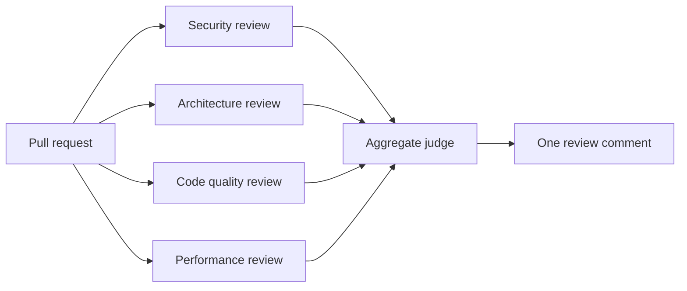

# Chapter 6 · Agentic Code Review

[中文](../zh/06-代理代码审查.md) | **English**

## Original materials covered

| Type | Date / speaker | Topic | Official links |
|---|---|---|---|
| Lecture | 10/27 · Mihail Eric | Agentic code review: best practices and architectures | [Slides](https://docs.google.com/presentation/d/1u8WYtFj0O9yc4H4JX9D4URYKhDzvrAGKLzn38DXSrak/edit) |
| Guest | 10/29 · Silas Alberti (Chief Research Officer, Cognition) | Guest lecture | No materials published yet |
| Reading | — | Layered Code Review and Risk-Based Human Oversight | [X](https://x.com/addyosmani/status/2114604912520921136) |
| Reading | — | Coordinating Specialist Review Agents at Scale | [Cloudflare](https://blog.cloudflare.com/ai-code-review) |
| Reading | — | Beyond the Diff: Context, Testing, and Model Selection | [Greptile](https://greptile.com/blog/how-to-build-a-code-review-agent) |
| Weekly notes | Week 6 | Notes | [Appendix: Week 6 notes](../../weeks/week06/en/notes.md) |

## Learning goals

1. Explain the two jobs of code review and why it became the bottleneck in the AI era;
2. Understand the maturity ladder from all-human review to multi-agent, risk-tiered review;
3. Sketch a multi-agent review architecture and explain the aggregate judge;
4. Apply the design principles of a review agent: switch models, give context, actually run the code, control cost, evaluate;
5. Know what AI review still does poorly and where humans should stay in the loop.

## 6.1 Why review matters, and why it is now the bottleneck

The slides open plainly: code review is one of the highest-leverage things you can do to grow as an engineer and raise your team's code quality. It does two jobs — catch and fix bugs before production, and keep the whole team's mental model of the system in sync as the code changes.

Review catches five kinds of problems: logic and correctness, readability and maintainability, performance, security, and the team's unwritten best practices.

The trouble is speed. Chapters 1–5 made agents write more code, faster, while review is still a human reading line by line. The slides' verdict: **review is the new bottleneck**. Cloudflare's article notes that internally, the wait for a first review was often measured in hours.

## 6.2 The maturity ladder

| Stage | Approach | Problem or strength |
|---|---|---|
| Stage 0 | Humans review everything | Doesn't scale |
| Stage 1 | A single review agent | Better with a find-and-auto-fix loop, but leaves gains on the table |
| Stage 2 | Multi-agent, risk-tiered review with built-in self-improvement | Where many companies are converging |

One detail of stage 2: the team's engineering standards live in a skill knowledge base (Chapters 3–4). The reviewer doesn't rely on one magic prompt; it reads the rules the team wrote down.

## 6.3 Multi-agent review architecture



A PR fans out to specialist reviewers, each owning one concern, and an aggregate judge merges the verdict. The slides use Cloudflare as the example. Per their public write-up, the system launches up to seven specialists (security, performance, code quality, documentation, release management, internal-standards compliance and more); a coordinator dedupes, re-categorizes, filters out speculation and nitpicks, then decides whether to approve.

Ideas worth borrowing from that article:

- **Say what not to flag**: e.g. the security reviewer reports only issues that are actually exploitable, not theoretical risks with unlikely preconditions. The article argues this is where the real prompt-engineering value is;
- **Severity levels**: each finding is critical, warning or suggestion; only critical issues block a merge;
- **Risk tiers**: a typo fix doesn't need seven agents. Small diffs get two; anything touching auth or crypto paths always gets the full panel;
- **Human override**: for a hotfix, a human can force approval with one comment.

Here is a minimal tiering function we wrote to illustrate the idea. The thresholds are arbitrary, not any company's real configuration:

```python
def risk_tier(files_changed: int, lines_changed: int, touches_sensitive: bool) -> str:
    """Decide how many review agents to dispatch (illustrative)."""
    if touches_sensitive or files_changed > 50:
        return "full"      # every specialist reviewer
    if lines_changed <= 10:
        return "trivial"   # coordinator + one generalist
    if lines_changed <= 100:
        return "lite"      # add code quality and docs
    return "full"
```

## 6.4 Designing a review agent

This part of the slides draws on Greptile's article. Its arc: a basic review agent takes a day to build — receive GitHub webhooks, read the diff, post comments — but it misses bugs, doesn't understand the codebase, is expensive, nitpicks, and finds new issues on every run. Then you improve it step by step:

1. **Switch models (model inversion)**: if the same vendor's model writes and reviews the code, they share blind spots. The slides call it a model inverter — have GPT review Claude's code and vice versa. Greptile reports roughly 10% more bugs caught this way;
2. **Thoughtful context**: diff-only review misses chained effects such as auth bypasses. Connect the agent to docs and the issue tracker, ideally with a codebase index or wiki that records past incidents and reverts;
3. **Actually run it**: spin up a dev container, install dependencies, start the app and click through it in a browser — more reliable than a model staring at code;
4. **Pick models per task**: the slides suggest cheap/fast models for gathering code context, small/medium models with higher reasoning for browser use, and frontier models only for deep bug analysis;
5. **Evaluate**: real bugs are rare, so evaluation is hard. The slides suggest a test set of historical PRs with known bugs and incidents that led to reverts.

> [!NOTE]
> **Supplement**
> This continues the book's thread: Chapter 1 said an agent is limited by what it can see and verify, and a review agent is no different; Chapter 5's readiness checklist (tests, reproducible builds) is the precondition for "actually run it".

## 6.5 Tools

The slides list two groups: general review — Claude Code, Greptile, CodeRabbit, Devin; security-focused — Vercel deepsec, Wiz, Semgrep. Semgrep's CEO is the guest in Chapter 7 on security.

## 6.6 What AI review still does poorly

Cloudflare's article lists its limitations honestly, which doubles as a checklist of where humans should look:

- **Architecture**: the reviewer sees the diff and nearby code but not why the system was designed this way, or whether a change moves it in the right direction;
- **Cross-system impact**: it can flag an API contract change but can't confirm every downstream consumer was updated;
- **Concurrency**: timing-dependent race conditions are hard to spot in a static diff;
- **Cost grows with diff size**: reviewing a several-hundred-file refactor is expensive.

So today AI review doesn't replace humans; it points human attention at the places that are actually risky.

## Guest sidebar: Silas Alberti (Chief Research Officer, Cognition, 10/29)

> [!NOTE]
> **Supplement**
> No materials from this talk have been published yet. Cognition makes Devin, which also appears on this lecture's tool list. We'll add the talk once materials are public.

## Hands-on

1. Review one of your PRs with models from two different vendors and compare what each finds;
2. Add a "what not to flag" section to your review prompt and rerun; compare the number and quality of comments;
3. Using the tiering function in 6.3, define a list of sensitive paths for your repo;
4. Find a past bug-fix commit, give the pre-fix version to a review agent, and see whether it spots the bug.

## Self-check

- [ ] I can name the two jobs of code review and the five kinds of problems it catches
- [ ] I can name the three stages of the maturity ladder
- [ ] I can sketch a multi-agent review architecture and explain the aggregate judge
- [ ] I can explain model inversion and why it helps
- [ ] I can name at least two current limitations of AI review

## Next chapter

Among review agents, security is special: one missed issue can cost far more than an ordinary bug. Chapter 7, "Security in AI Codebases", will be added after the 11/3 lecture.
