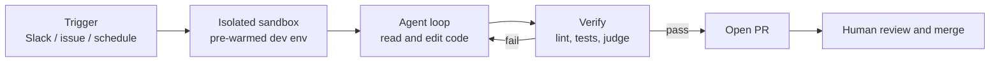

# Chapter 8 · Background Agents

[中文](../zh/08-后台代理.md) | **English**

## Source materials for this chapter

| Type | Date / Speaker | Content | Official link |
|---|---|---|---|
| Lecture | 11/10 · Mihail Eric | Background agents: launching tasks asynchronously | [Slides](https://docs.google.com/presentation/d/1R8Pr3RNAFQiw8mHKbXopOhxi_h9zuEeUKrJkxCZ5Fio/edit) |
| Guest | 11/12 · Rajesh Bhatia (Senior Director, Cloudflare) | Guest lecture | Materials not yet published |
| Reading | Spotify | From Migration Scripts to Agent Fleets (Honk, part 1) | [Spotify Engineering](https://engineering.atspotify.com/2025/11/spotifys-background-coding-agent-part-1) |
| Reading | Stripe | From Slack Message to Review-Ready PR (Minions) | [stripe.dev](https://stripe.dev/blog/minions-stripes-one-shot-end-to-end-coding-agents) |
| Reading | Ramp | Giving Agents the Tools to Prove Their Work (Inspect) | [Ramp Builders](https://builders.ramp.com/post/why-we-built-our-background-agent) |
| Reading | LangChain | Inside an Open-Source Software Factory (open-swe) | [GitHub](https://github.com/langchain-ai/open-swe) |
| Cited in slides | Walden Yan (Cognition) | Multi-Agents: What's Actually Working | [X](https://x.com/walden_yan/status/2047054401341370639) |
| Supplementary | Spotify | Predictable Results Through Strong Feedback Loops (Honk, part 3) | [Spotify Engineering](https://engineering.atspotify.com/2025/12/feedback-loops-background-coding-agents-part-3) |
| Related video | Rajesh Bhatia | Cloudflare's AI Engineering Stack: Assisted to Delegated | [YouTube](https://www.youtube.com/watch?v=MbLdrAZFQRs) |
| Weekly notes | Week 8 | Original notes | [Appendix: Week 8 notes](../../weeks/week08/en/notes.md) |

## Learning goals

1. Explain how background agents differ from the "sit at the terminal with the agent" style of Chapters 1–7, and why they enable parallelism;
2. Break a background agent platform into five questions: where it runs, where tasks come from, what it can access, how it proves its work, and who it hands off to;
3. Understand why the verification loop is the core of a background agent, and name Spotify's three failure modes;
4. Know three multi-agent patterns and why the ones that work today mostly have one agent writing while others advise;
5. Know which metrics to watch for a background agent platform.

## 8.1 From pairing to dispatching

Most agents in the first seven chapters were synchronous: you ask for something in a terminal, watch it read files, edit code and run tests, and step in whenever you like. The ceiling is human attention; you can only watch one session at a time.

The slides split coding-agent capability into three stages: tab completion in 2021, about 15% efficiency gain; synchronous single tasks in 2024, about 25–35%; and background multi-task work from 2026, aiming for 2x or more. The first two stages make a person type faster. The third changes the approach: the person no longer watches each task, but sends several off at once, lets them finish elsewhere, and comes back to the results.

Chapter 6 already showed one case. A review agent fires automatically when a PR opens; nobody starts it. This chapter extends the idea to writing code itself: start from a Slack message, an issue or a schedule, and end with a reviewable PR.

> "Spawning multiple concurrent tasks in asynchronous contexts → massive parallelism"
> 在异步环境中同时派出多个任务，换来大规模并行。
> —— Lecture 15 slides (11/10)

For that, the agent can no longer run on your laptop. The slides call it the "end of localhost": environments are built centrally in the cloud, so "works on my machine" goes away; every run is the same and reproducible; tests run on dedicated machines; and you open as many in parallel as you need.

## 8.2 Taking a background agent platform apart

The slides define a background agent platform as a system that takes a task, spins up a production-like dev environment, runs the whole workflow end to end and returns a PR. Reading the four assigned posts side by side, each implementation answers the same five questions.

| Question | What you decide | Examples from the readings |
|---|---|---|
| Where does it run? | How sandboxes are made, how fast they start, what they are isolated from | Stripe's devboxes start in ~10 seconds; Ramp uses Modal sandboxes and snapshots |
| Where do tasks come from? | Where people ask, and how the system picks the repo | Slack, GitHub, Linear, internal tickets, flaky tests found by CI |
| What can it access? | Code, docs, logs, metrics, tools | Stripe's Toolshed hosts 400+ MCP tools |
| How does it prove its work? | Which checks run, and what happens on failure | Spotify's verifiers and judge; Stripe's at-most-two CI rounds |
| Who does it hand off to? | Whose identity opens the PR, who reviews | Ramp opens PRs with the requester's GitHub token |

The next sections take these one at a time.

## 8.3 Environment: fast, isolated, reproducible

A background agent's environment has to meet three conditions, and they pull against each other.

**First, fast.** If an environment takes minutes to start, people won't open one casually, and parallelism never happens. Ramp defines an image per repository and rebuilds it every 30 minutes, doing the clone, dependency install and first build ahead of time and saving a snapshot; a session restores from the snapshot and only has to sync at most 30 minutes of new commits. They also warm the sandbox as soon as the user starts typing, and let the agent read files before the sync finishes while blocking writes until it does. Stripe's devboxes are pre-warmed too: about 10 seconds to a machine with code and services loaded.

**Second, isolated.** Stripe's devboxes are cut off from production resources and the internet, so minions can run on them without per-action human permission checks. This matters: the more thorough the isolation, the less often the agent must stop and ask, and only then is unattended work possible.

**Third, the same as what humans use.** The Stripe post puts it plainly:

> "if it's good for humans, it's good for LLMs, too."
> 对人好用的东西，对大模型也好用。
> —— Stripe, Minions part 1

Minions use the same devboxes, rule files, linters and tests as Stripe's engineers. Ramp's Inspect does the same: the sandbox has everything an engineer has locally. Years of developer tooling get reused instead of building a separate stack for agents.

If you don't want to build sandboxes yourself, the slides list providers: Coder, Vercel Sandbox, Daytona, E2B, Modal.

## 8.4 Triggers and entry points: go where people already are

Entry points decide who uses the system. All four readings put Slack first.

Stripe engineers most often tag the bot in the Slack thread where a change is being discussed, and the minion reads the whole thread and its links as context. Internal docs, feature flags and ticketing also integrate with minions; when CI detects a flaky test, it files a ticket with a button that starts a minion to fix it.

Spotify adds a step: the user first talks to an interactive agent that clarifies the task and produces a prompt, which is then handed to the background coding agent. Writing the prompt is itself delegated.

Ramp adds a repository classifier to its Slack entry point: the message, thread context and channel name go to a fast model that picks the repo, with an "unknown" option so it can ask. Users learn no command syntax.

> [!NOTE]
> **Supplement**
> A side effect of many entry points is easy to miss: working in public channels is itself promotion. Ramp says it didn't force anyone to use Inspect; it let Inspect work in public spaces, and people learned by watching. Conversely, a platform reachable only from an internal web page will spread slowly however good it is.

## 8.5 Verification: make the agent prove its work

With nobody watching, a wrong turn goes uncorrected. So the most important part of a background agent platform is not the agent but the verification loop around it.

In Honk part 3, Spotify sorts failures into three kinds, in rising severity:

1. The agent fails to produce a PR. A minor annoyance; a person can make the change by hand;
2. The agent's PR fails CI. An engineer must decide whether to rescue half-broken code;
3. The PR passes CI but is functionally wrong. The worst, because it erodes trust in automation and is hard to spot in review across thousands of components.

The usual causes of the last two: thin test coverage in the target component; the agent "getting creative" outside the prompt's scope; or the agent not working out how to build and test.

Spotify built two layers in response:

- **Deterministic verifiers.** Activated by repo contents, e.g. a Maven verifier when a `pom.xml` is present. The agent sees a single "verify" tool and doesn't need to know which build system runs behind it; the verifier condenses long output into a few key error lines, saving the agent's context. The agent can call it any time, and it is forced to run again before a PR opens (via a stop hook in Claude Code); if it fails, no PR.
- **An LLM judge.** The diff and the original prompt go to a model that checks for overreach. Spotify reports the judge vetoes about a quarter of thousands of sessions, the agent recovers about half the time after a veto, and the most common trigger is doing things outside the prompt.

Stripe's approach is to "shift feedback left": catch locally whatever you can instead of waiting for CI. Every git push first runs local lints in under five seconds; CI then selects relevant tests from more than three million, auto-applies fixes where available, and sends the rest back to the minion. CI is expensive, so there are at most two rounds: fix once after the first failure, push again, then stop.

The "prove" in Ramp's title means the same thing: backend changes must be able to run tests and check telemetry and feature flags; frontend changes come with screenshots and live previews. The agent returns not just code but evidence that it is right.

## 8.6 Permissions: who holds the keys

Chapter 7 introduced the lethal trifecta: private data, untrusted content, external communication. Background agents often touch all three with nobody watching live, so permissions need to be more conservative.

Practices from the readings worth borrowing:

- **Isolated environments:** Stripe's devboxes have no production or internet access; Spotify's agent can only see the relevant codebase, edit files and call verifiers, while pushing code and talking to people in Slack are handled by surrounding infrastructure, and the container it runs in has few permissions;
- **Open PRs as the human:** Ramp recommends opening PRs with the requester's GitHub token rather than as the app. Otherwise anyone could approve a change they requested and a bot submitted, creating a path around review;
- **Least privilege:** open-swe's README warns that sandboxes have powerful tools and may have network access; use least-privilege credentials and restrict repositories and integrations.

Spotify notes an easily missed benefit: the less an agent can do, the more predictable it is. Restricting permissions is about stability as well as security.

## 8.7 Parallelism and multiple agents

Once environments are unlimited, the next question is how multiple agents work together. The slides cover three patterns.

**Agent teams.** The Claude Code docs give two examples: for a hard bug, spawn 5 agents to each test one hypothesis, have them argue, and write the consensus into a findings doc; for a PR review, spawn three reviewers for security, performance and test coverage.

**Generator-verifier.** One agent writes, another reviews. Walden Yan of Cognition found that having the same model review its own code still works, and works best when the reviewer and writer share no context beforehand: the reviewer sees only the diff, free of the long context the writer accumulated, and it questions things the writer overlooked because of the user's instructions.

**Primary model with a smart friend.** A cheap, fast primary model hands its context to a stronger model when it gets stuck and asks for advice. The hard part is that a weaker model doesn't know well when it has hit its limits. Cognition admits that with its own small model as the primary this didn't work well enough; pairing two frontier models is where it paid off, and then it behaves more like routing each sub-task to the model best at it.

The three share one property, in Walden Yan's words:

> "multi-agent systems work best today when writes stay single-threaded and the additional agents contribute intelligence rather than actions."
> 今天的多代理系统，在写操作保持单线程、其他代理贡献判断而不是动作时效果最好。
> —— Walden Yan, Multi-Agents: What's Actually Working

The reason: every write carries implicit choices about style, edge cases and code patterns, and several agents writing at once make conflicting choices.

The slides end with "meta skills" for orchestrating many agents: delegating and breaking down work; judging complexity before starting; keeping planning sessions separate from quick-task sessions; reading code and plans fast enough, since review is the new bottleneck; and adding agents step by step instead of starting twenty at once.

## 8.8 Measuring a background agent platform

Ramp's advice: build a statistics page, and make the headline metric **how many sessions end in a merged PR**. A merge means the agent produced something valuable; session and token counts only show it was busy.

The numbers in the readings all revolve around merges:

| Company | Reported result |
|---|---|
| Spotify | 1,500+ agent-generated PRs merged; 60–90% time savings on migrations vs. by hand |
| Stripe | Over a thousand merged PRs a week entirely minion-produced, human-reviewed |
| Ramp | At the time of the post, about 30% of merged PRs in frontend and backend repos written by Inspect |

These come from each company's own posts with different definitions, so don't compare them directly. The direction is the same: get one kind of task merging reliably, then widen the scope.

## Guest sidebar: Rajesh Bhatia (Senior Director, Cloudflare, 11/12)

> [!NOTE]
> **Supplement**
> No materials or recording published yet. In his LinkedIn preview the speaker said the talk covers what your coding agent does after you close your laptop: where it runs, who holds the keys, what it costs while it waits, and how it tells you something went wrong, along with Cloudflare's architecture and seven principles. Those four questions map onto sections 8.3, 8.6, 8.8 and 8.5.
>
> For background, see the Cloudflare post he co-authored, [The AI engineering stack we built internally](https://blog.cloudflare.com/internal-ai-engineering-stack/) (2026-04-20): it reports 93% of Cloudflare's R&D using AI coding tools in the previous 30 days, AI review on every merge request, and AGENTS.md generated for about 3,900 repos; it closes by naming background agents as the next step, orchestrated with Durable Objects and the Agents SDK and delegating to Sandbox containers when a full dev environment is needed. His public talk at Ona, [Cloudflare's AI Engineering Stack: Assisted to Delegated](https://www.youtube.com/watch?v=MbLdrAZFQRs), follows the same path. He said he would share the slides afterwards; we will add them once available.

## Related videos

- [Will Repos Become Software Factories? — Mihail Eric](https://www.youtube.com/watch?v=dpY7YzZo4kE): Latent Space interview in which the instructor explains why Week 8 uses these companies' write-ups.
- [How Spotify runs agents across 20M+ lines of code](https://www.youtube.com/watch?v=9DHZLw5653E), [Building autonomous coding agents at Stripe](https://www.youtube.com/watch?v=WW-549L6L50), [How to build an agent that builds the culture — Zach Bruggeman, Ramp](https://www.youtube.com/watch?v=MDI81OaZAD4): public talks from the companies behind the readings.
- Full list: [Video resources](../../VIDEOS.en.md).

## Exercises

1. With open-swe or any sandbox service (E2B, Modal, Daytona, ...), build a minimal flow: labeling a GitHub issue starts an agent in a sandbox, which opens a PR when done;
2. Write a "verify" script for your repo that condenses lint, type-check and test output into a few key lines, and require the agent to call it before opening a PR;
3. Write a judge prompt that takes a diff and the original task and only decides "did it do anything outside the task?"; try it on a few of your past PRs;
4. Fill in Section 8.2's five questions for Spotify, Stripe and Ramp, and find the question where they differ most.

## Self-check

- [ ] I can explain synchronous vs. background agents and why the latter parallelize
- [ ] I can break a background agent platform into five questions
- [ ] I can name Spotify's three failure modes and which is worst
- [ ] I can explain why PRs should be opened as the requester, not the bot
- [ ] I can name three multi-agent patterns and the reason for single-threaded writes
- [ ] I know the most important metric for a background agent platform

## Next chapter

One background agent handling one kind of task is a production line. Connect triage, spec, implementation, review, verification and monitoring, and let the system improve itself from failures, and you have a software factory. See [Chapter 9, "The Software Factory"](09-the-software-factory.md).
