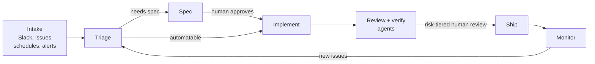

# Chapter 9 · The Software Factory

[中文](../zh/09-软件工厂.md) | **English**

## Source materials for this chapter

| Type | Date / Speaker | Content | Official link |
|---|---|---|---|
| Lecture | 11/17 · Mihail Eric | The Software Factory and self-improving software systems | [Slides](https://docs.google.com/presentation/d/1hxlLspHQ2WOs2tZmCN3gdDi7dfbbRorxzPr65HyyE6Y/edit) |
| Guest | 11/19 · Michele Catasta (President, Replit) | Guest lecture | Materials not yet published |
| Reading | Warp | From Issue to Pull Request: A Warp Factory Example | [GitHub](https://github.com/warpdotdev/warp-factory-examples/tree/main/examples/02-sdlc-issue-to-pr) |
| Reading | Ona | The Software Factory | [software-factory.dev](https://software-factory.dev) |
| Reading | — | OpenInspect | [openinspect.dev](https://openinspect.dev) |
| Reading | Zach Lloyd (Warp) | WarpBench: Evaluating Coding Agents | [Warp](https://warp.dev/factories/benchmarks/warpbench) |
| Cited in slides | Zach Lloyd | Adopting the software factory model: crawl, walk, run | [Warp Blog](https://www.warp.dev/blog/adopting-the-software-factory-model-crawl-walk-run) |
| Cited in slides | Eric Zakariasson (Cursor) | Building your own software factory (AIE Europe 2026) | [YouTube](https://www.youtube.com/watch?v=rnDm57Py54A) |
| Cited in slides | Zach Lloyd | How to Build a Software Factory That Improves Itself | [YouTube](https://www.youtube.com/watch?v=nKjPBAw_N_0) |
| Weekly notes | Week 9 | Original notes | [Appendix: Week 9 notes](../../weeks/week09/en/notes.md) |

> [!NOTE]
> **Supplement**
> The official schedule changed after the term began: Week 9 was originally "Building an AI-Native Team" and is now "The Software Factory"; the AI-native team topic moved to Week 10. This chapter follows the current schedule.

## Learning goals

1. Explain the three parts of a software factory (production line, quality control, feedback loop) and how it differs from Chapter 8's single background agent;
2. Draw a software factory's structure and point out the three human gates and two loops;
3. Understand why the factory definition belongs in code, and read a factory configuration;
4. Know how judges and private benchmarks show whether the factory is improving, and which metrics to watch;
5. Know why post-deployment monitoring and security are the most underrated part of a factory, and how a team can adopt one in stages.

## 9.1 From a production line to a factory

Chapter 8's background agent takes one kind of task and returns a PR: a production line. Real software work is more than writing code. A reported bug needs reproducing first; a vague request needs a spec; finished code needs review, verification and release; after launch someone has to watch it, and problems send you back to the start.

Hand all of those steps to agents, and let the system learn from its own failures, and you get what the slides call a software factory. The slides' reason is that coding agents are now strong enough for people to step back:

> "we're moving toward a world of orchestrating software tasks with humans on the loop rather than in the loop"
> 我们正在走向这样一个世界：编排软件任务时，人站在回路之上，而不是身处回路之中。
> —— Lecture 17 slides (11/17)

"In the loop" means a person does one of the steps, such as writing the code. "On the loop" means the person designs and supervises the loop and decides only at key points. The slides add that most software work follows a fairly predictable shape, so automating it is the natural next step.

The slides split a software factory into three parts:

| Part | What it does |
|---|---|
| Production line | A fleet of cloud background agents that take work from where it starts (an issue, a Slack thread, a Sentry alert, a cron schedule), do it in an isolated environment and return a PR |
| Quality control | CI, static analysis, tests and an AI reviewer that check every artifact against the same standard, whoever or whatever prompted it |
| Feedback loop | When a defect slips through, capture why and turn it into a doc, a skill, a lint rule or a tool so the defect rate falls over time |

The first two appeared in Chapters 6 and 8. The third is new, and it is where "self-improving" comes from.

## 9.2 Prerequisite: agents must be able to run on their own

The slides list three prerequisites: tool access, an isolated control plane, and agent readiness. For agent readiness they cite Eric Zakariasson of Cursor at AIE Europe 2026, as three questions:

1. **Runnable?** Can an agent start your dev environment with no human involved? If so, you can scale out on separate VMs;
2. **Accessible?** Can the agent reach the external context and tools the task needs?
3. **Verifiable?** Can it verify its own changes?

These follow directly from Chapter 5, "Agent-Ready Codebases". The difference is that Chapter 5 aimed to make the agent next to you err less; here the aim is to let hundreds of unattended agents work at once. Fail any one, say starting the dev environment needs someone to type a password, and the factory can't be built. In an X post on 11/20 the instructor summarized this as "agent readiness comes first."

## 9.3 The structure of a factory

The slides use a diagram by Zach Lloyd (CEO of Warp). Below is our simplified redraw based on the slide's description:

Three things to take from it.

**First, each agent does one job.** The triage agent decides whether a task can be automated: if so, straight to implementation; if scope or meaning is unclear, to the spec agent first; if it's too vague, ask a person for more or park it. The implementation agent writes code, the review agent reviews, and the verification agent checks results via computer use (opening pages as a person would) or other means. Each agent runs in its own isolated sandbox.

**Second, humans hold three gates.** Approving the spec, risk-tiered code review, and a product check. People no longer appear at every step, but they must appear at these three.

**Third, there are two loops.** In one, the monitoring agent files issues for problems it finds and sends them back to triage, closing the loop. The other goes further: the factory's telemetry (cost per PR, cycle time, human touches per PR) goes to observer agents that open PRs against the factory's own definition, which humans review and merge. The second loop is the feedback loop of Section 9.1: the factory improving itself.

In an internal memo to the Warp team, Zach Lloyd wrote that every time a human has to step in, the platform should record it and have self-improvement agents adjust the flow so a human is less likely to be needed next time.

## 9.4 Writing the factory as code

A factory has many agents, rules and triggers; clicking through web settings quickly becomes unmanageable. The slides compare two approaches:

- **Frankenstein:** stitch existing tools together, e.g. one Claude automation for review and Devin for bug fixes;
- **Infrastructure as code:** like managing cloud resources with Terraform, write the whole factory definition as files in the repo that you can diff, review and roll back.

The benefit of the second becomes clearer in Section 9.5: only a versioned configuration lets you compare "before" and "after".

The Warp example in this week's readings is a factory written as code. Its layout is roughly:

| Directory | Contents |
|---|---|
| `agents/` | Five default agents, FOREMAN (dispatcher), TRIAGE, SPEC, IMPLEMENT, REVIEW, plus a custom mobile-build agent; one `agent.md` each |
| `automations/` | Triggers: Slack mentions, Slack DMs, Linear sessions, GitHub mentions/assignments, follow-up when a PR is closed or merged |
| `runners/` | Compute: 4 vCPU / 8 GB Linux for stages that read code and write prose, 8 vCPU / 16 GB for compiling and testing, macOS for mobile |
| `scorers/` | Scorers: one for implementation runs with self-improvement on, one for review runs |
| `skills/` | Repository conventions shared by every agent; agent-specific skills live under that agent's directory |

A few details stand out:

- **The reviewer uses a different model from the implementer** to reduce shared blind spots, matching Chapter 6's advice to switch models for review;
- **Compute is allocated by stage:** reading code and writing prose don't need big machines; compiling and testing do;
- **Triggers are kept tight:** GitHub intake fires only when a mention/assignment filter *and* the factory's routing label both match. The example warns that dropping the label filter makes any mention start work, and dropping the mention filter too makes it fire whenever anyone is mentioned. For a factory that writes code on its own, an over-wide intake wastes money and is a security problem.

## 9.5 Quality control: judges and private benchmarks

To improve itself, a factory first has to tell good from bad. The slides offer two tools.

**Judges score every run.** An LLM grades each whole run against the spec instead of going on vibes. Chapter 8 covered Spotify's judge, which checks the diff against the original prompt and vetoes about a quarter of sessions. Zach Lloyd's demo includes a scorer that specifically catches agents writing redundant tests. You can have many judges, each responsible for one dimension.

**Benchmark on your own history.** Public benchmarks have two problems: their tasks have little to do with your work, and they may have leaked into model training data. Replaying your own past tasks is more reliable. WarpBench does exactly that:

1. The dispatcher agent picks 30 representative tasks from past agent runs, sized S, M, L and XL, spanning server and client code;
2. git restores the code as it was, and the factory configuration as it was, so agent definitions and skills stay constant;
3. The tasks replay in their original environments with different models, and judges score them on cost, quality and other dimensions.

A full run took 3h 46m and cost $2,130.57, so the post advises against running it often; run it when new models ship or code, skills or MCPs change significantly. After switching the default implementation model based on the results, Warp says internal cost per completed PR fell from about $80 to about $30, merge rate held, and task-compliance scores rose from 69% to 87%.

> [!NOTE]
> **Supplement**
> These numbers are self-reported by Warp. The slides specifically caution that Zach Lloyd's cost-per-PR figures vary across sources, so treat it as a downward trend. Note also that step 2 is only possible because the factory definition is code (Section 9.4). If configuration were scattered across web dashboards, you couldn't restore "the factory as it was."

## 9.6 Self-improvement: every failure makes the system better

The feedback loop is simple to state: when a defect slips through, record why and turn it into a doc, skill, lint rule or tool. The hard part is treating every failure as a chance to improve the system rather than just fixing that one bug.

The slides put it plainly: an agent going off the rails is a signal to improve the factory. That is most of what being "on the loop" means. The instructor's 11/20 X post lists it as a core factory principle.

Ona's public experiment gives a concrete case. Over ten days they built a Notion-style notes app with agents. On day 5 the company's COO stress-tested it and filed 12 bugs. The factory had been fixing bugs all along, just not the same ones: runtime errors reported through Sentry it could find and fix by itself; visual and interaction problems still needed a person to point out. On stream they showed a self-improvement loop driven by a `quality.md` file and filed bugs live to watch how the factory handled them.

The lesson: how much the feedback loop covers depends on how much the system can "see." For problems it can't see, a person has to fill in, or you find a way to make them visible.

## 9.7 After deployment: monitoring and security

The week's third syllabus topic is running and securing agents after deployment. It is the most underrated part. One of Ona's main takeaways at the end of their experiment: the operations side of the factory needed more automations than the build side.

After deployment there are three concerns:

- **The monitoring loop:** a monitoring agent files issues for problems and sends them back to triage (the first loop in 9.3). The slides' list of tasks suited to a factory includes first-pass investigation of production incidents and security vulnerabilities;
- **Risk tiers:** low-risk changes can be auto-approved, high-risk ones go to people. The slides are explicit that humans own security, data and payments;
- **Being able to stop:** this week's guest, Replit President Michele Catasta, cited a survey in an early-November X post: 86% of organizations surveyed have agents running, but under 18% can automatically stop one that misbehaves. His conclusion: managed, isolated cloud agents should be the default for autonomous development.

Replit's blog calls this controlled environment an "Agent Habitat": it controls access, defines when human approval is required, and limits the impact of mistakes; when someone corrects an agent, the correction should be reviewed and made available to improve future work. Same idea as the feedback loop in 9.6, extended from code to the whole company.

## 9.8 The human role and factory metrics

Once the factory exists, what do people do? The slides give four points:

1. **Move from worker to manager:** plan synchronously, execute asynchronously;
2. **Route review by risk:** humans own security, data and payments;
3. **Treat an agent going off the rails as a signal to improve the factory;**
4. **Humans stay accountable for what ships.**

A factory is measured by what each shipped change costs, not by how much it produces:

| Metric | Meaning |
|---|---|
| Cost per PR | Models plus compute: what one shipped change costs |
| Cycle time | From task intake to merge |
| Human touches per PR | How many times people stepped in; fewer means a more mature factory |
| Share through the factory | What fraction of merged PRs the factory produced |

The slides say explicitly: not lines of code, not tokens. Both are easy to inflate and loosely tied to delivered value.

Ona's day-ten numbers offer a reference point: 375 PRs merged in ten days, 50k+ lines of code, 16 automations, 1,067 tests, an 87% autonomous rate, and a median PR-to-merge time of 4.9 minutes. Their summary:

> "You don't build Memo, you build a factory to build Memo."
> 你不是在做 Memo，而是在做一座生产 Memo 的工厂。
> —— Ona, The Software Factory, day 10

## 9.9 Getting started: crawl, walk, run

Building a whole factory at once isn't realistic. The slides cite Zach Lloyd's three stages:

1. **Crawl:** start with point automations on chores, such as triaging new issues, reviewing PRs automatically, fixing bugs from Sentry alerts, and healing broken CI. Pick standardized repos with good tests. Low risk; the main gain is building intuition for agents;
2. **Walk:** get one end-to-end factory working on a simple product surface, such as a marketing site or internal tool. About 75% of changes to Warp's marketing site go through such a factory, with people only describing the change in Slack or the task tracker;
3. **Run:** once the basic loop is stable, extend to complex repos. Remote dev environments, cost, security auditing and multi-stakeholder coordination become the new bottlenecks.

Three more pieces of adoption advice: meet people where they already work (Slack, Linear, GitHub) instead of a new portal; encourage use but don't require it; and let risk tiers decide which changes still need human review.

Zach Lloyd argues point automations eventually hit a ceiling: they don't share context, so improvements to review don't carry over to triage or verification, and there is no global view of whether overall productivity is improving. That is the reason to move from crawl to walk.

## Guest sidebar: Michele Catasta (President, Replit, 11/19)

> [!NOTE]
> **Supplement**
> No materials or recording published yet. The instructor's preview says Replit calls itself a "self-driving company" and predicts every Fortune 500 company will be one by 2030; Replit's engineers nearly tripled code output in the first half of 2026 while review times, reverts and incidents stayed flat.
>
> For background, read Replit's blog post [The Rise of the Self-Driving Company](https://replit.com/blog/rise-of-self-driving-company) (by Amjad Masad): people set goals, exercise judgment and stay accountable; agents execute within clear boundaries, enforced by the "Agent Habitat" described in 9.7. Two days before the lecture (11/17), Replit launched Missions, which coordinates multiple agents toward one outcome, with users setting a spending cap and which actions need approval. Catasta's public talks closest to this chapter are [The 3 Pillars of Autonomy](https://www.youtube.com/watch?v=MLhAA9yguwM) (AI Engineer, 2025-12) and [Evaluating and improving Replit Agent at scale](https://www.youtube.com/watch?v=snroDwX1-JU) (2026-05, on how Replit evaluates and improves its agent). Will be added once materials are published.

## Related videos

- [Building your own software factory — Eric Zakariasson, Cursor](https://www.youtube.com/watch?v=rnDm57Py54A): cited in the slides; source of Section 9.2's runnable / accessible / verifiable.
- [How to Build a Software Factory That Improves Itself — Zach Lloyd](https://www.youtube.com/watch?v=nKjPBAw_N_0): cited in the slides; on scorers and private benchmarks.
- [Software Factory in Public: 375 PRs in 10 Days](https://www.youtube.com/watch?v=a4pEznCiWNo): recap of Ona's experiment.
- Full list: [Video resources](../../VIDEOS.en.md).

## Exercises

1. Clone Warp's `warp-factory-examples`, read `02-sdlc-issue-to-pr`, and trace which agents, defined in which files, a GitHub issue passes through on its way to a PR;
2. Check your own project against Section 9.2's three questions: which step needs a person to start the dev environment?
3. Pick 10 of your past PRs, size them, and make a small benchmark; run it with two models and record cost and your quality score;
4. Write a lint rule or skill for the agent mistake you see most, and note whether it recurs;
5. Pick one low-risk chore (e.g. labeling new issues) and automate it as a "crawl" step.

## Self-check

- [ ] I can name the three parts of a software factory and which one makes it self-improving
- [ ] I can draw the factory structure and point out the three human gates and two loops
- [ ] I can explain why the factory definition should be code
- [ ] I can say why private benchmarks beat public ones and how WarpBench works
- [ ] I can name the factory metrics and why lines of code and tokens aren't among them
- [ ] I can describe what each of crawl, walk and run involves

## Next chapter

Once the factory is built, the question shifts from "how do agents do the work" to "how does an organization manage this many agents." Chapter 10 will be added after the 12/1 lecture; per the current schedule it covers the AI-native team (MCP portals, LLM gateways, model routing and cost optimization, org-wide adoption) and software taste.
