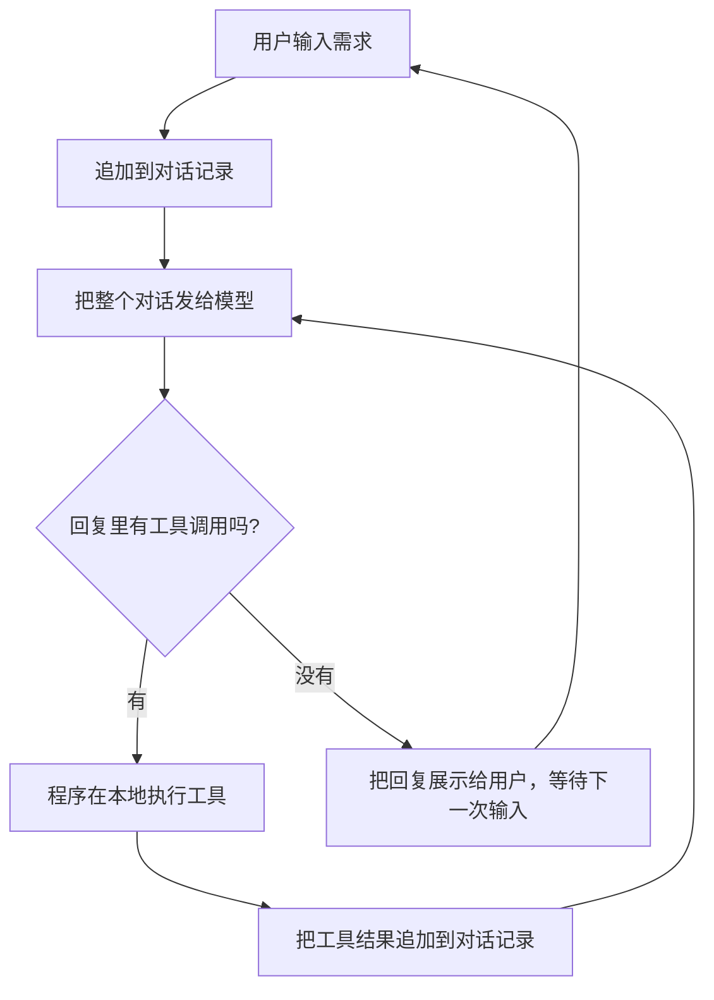

# 第 1 章　编程代理是怎么工作的

**中文** | [English](../en/01-how-coding-agents-work.md)

> 对应课程：第 1 周，9/22「课程介绍 + 用 200 行代码写一个 Claude Code」，9/24「现代编程代理解剖」。按日期查看原始笔记见 [学习路线](../../LEARNING_PATH.md)。

## 本章学习目标

读完这一章，你应该能够：

1. 用自己的话说清楚：一个「会写代码的大模型」本身能做什么、不能做什么；
2. 解释为什么 **代理 = 一个循环 + 一组工具**，并画出这个循环；
3. 读懂一个约 200 行的最小编程代理，知道每一块在干什么；
4. 说出现代编程代理（如 Claude Code）在最小代理之上多了哪些部件，每个部件解决什么问题；
5. 理解「上下文工程」为什么是后面所有章节的起点。

## 1.1 为什么从原理讲起

这门课开宗明义：它讲原则，不讲工具。今天流行的编程代理每隔几个月就换一批，但它们底下的结构几乎一样。只要弄懂了这个结构，换任何一个新工具，你都能很快判断它强在哪、弱在哪、该怎么喂它信息。

> "This class is about principles not tools"
> 这门课讲的是原则，而不是工具。
> —— 第 1 讲课件（9/22）

课程还提出了一个对开发者的判断：AI 让开发者的生产力达到历史最高，于是对开发者的期望也一起变高了。能被 AI 轻易替代的是「把需求翻译成代码」这一层；不容易被替代的，是理解业务、设计系统、判断代码好坏的能力。这本书的十章，基本都在训练后一种能力，而第一步就是看透你手里的工具。

## 1.2 起点：一个会写代码的大模型

先看最朴素的情况。大模型（LLM）本质上是一个函数：输入一段文本，输出一段续写的文本。代码也是文本，所以一个训练得足够好的模型，给它一段需求，它就能写出一段看起来合理的代码。

但它有三个先天限制：

- **它看不到你的项目。** 模型只知道你在这一次输入里给它的内容。你的仓库里有哪些文件、函数叫什么名字、测试怎么跑，它一概不知。
- **它不能动手。** 它只能「说」，不能读文件、改文件、跑命令。代码写出来，还得你复制粘贴、运行、再把报错贴回去。
- **它没有记忆。** 每次调用都是独立的。所谓「对话」，其实是每次都把之前的全部聊天记录重新发给它。

聊天窗口里的「AI 写代码」，就是你在人工充当这三件事的桥梁：你帮它看项目，帮它动手，帮它记住上下文。编程代理要做的，就是把这座桥自动化。

## 1.3 让模型能动手：工具调用

第一个突破是 **工具调用（tool calling）**。思路很简单：在给模型的说明里写清楚「你可以使用这几个工具，每个工具叫什么、需要什么参数、能做什么」，并约定一种格式。模型想看某个文件时，就输出一句按约定格式写的请求，比如：

```text
tool: read_file({"filename": "app.py"})
```

注意，模型自己并没有读文件。它只是输出了一行文字。真正读文件的是你写的程序：程序识别出这一行，在本地执行读文件，再把结果作为新的一段文本发回给模型。

所以，**工具调用本质上是一种文本协议**：模型负责「说要做什么」，程序负责「真的去做」，再把结果「说回去」。现在各家 API 都提供了原生的工具调用格式，但原理和上面这一行文字完全相同。

> [!NOTE]
> **补充**
> 这也解释了 9/24 课上的一个要点：工具的名字、描述和参数签名本身就是提示词的一部分。模型是靠读这些文字来决定何时、如何使用工具的，描述写得含糊，模型就会用错。

## 1.4 让模型能连续工作：代理循环

只调用一次工具还不够。修一个 bug 通常要先列目录、再读文件、再修改、再看结果，是一连串动作。于是有了第二个突破：把「调模型 → 执行工具 → 回填结果」放进一个循环里，直到模型不再请求工具为止。



这就是整门课最核心的一句话：**代理 = 一个循环 + 一组工具**。包住模型、负责这个循环的程序，课程里叫 **框架（harness）**。模型是大脑，框架是身体和神经系统：它决定模型能看到什么、能做什么、结果怎么回来。

这里有两个容易忽略的细节：

- **循环有内外两层。** 外层等用户说话；内层是代理自己连续干活，可能连续调用十几次工具，用户不用插手。
- **对话记录只增不减。** 每一次工具结果都会追加进去，再整体发给模型。这意味着干得越久，发给模型的内容越长。这个细节会在 1.7 节变成大问题。

## 1.5 动手看：一个约 200 行的编程代理

9/22 那节课现场从零写了一个最小编程代理，大约 200 行 Python。课程的示例代码没有开源许可，所以这里不转载，下面是我们按同样结构自己写的讲解版，省略了错误处理等细节。

**第一步：准备三个工具。** 只要能读文件、列目录、改文件，就已经能完成相当多的编程任务。

```python
def read_file(filename):
    """读取一个文件的全部内容"""
    return {"path": filename, "content": open(filename).read()}

def list_files(path="."):
    """列出目录里的文件和子目录"""
    return [{"name": n, "type": "dir" if os.path.isdir(n) else "file"}
            for n in os.listdir(path)]

def edit_file(path, old_str, new_str):
    """把文件中第一处 old_str 换成 new_str；old_str 为空则新建文件"""
    if old_str == "":
        open(path, "w").write(new_str); return "created"
    text = open(path).read()
    if old_str not in text:
        return "error: old_str not found"   # 把错误告诉模型，而不是让程序崩溃
    open(path, "w").write(text.replace(old_str, new_str, 1))
    return "ok"

TOOLS = {"read_file": read_file, "list_files": list_files, "edit_file": edit_file}
```

`edit_file` 用的是「精确字符串替换」：模型必须先读过文件，才能准确说出要替换哪一段。这个设计很朴素，却和成熟产品里的编辑工具是同一个思路。找不到时返回错误信息而不是抛异常，模型看到错误后通常会重新读文件再试，这就是代理「自我纠错」的来源。

**第二步：把工具说明写进系统提示词。** 不必手写，直接用函数的名字、文档字符串和参数签名自动生成：

```python
def describe_tools():
    return "\n".join(f"- {name}{inspect.signature(fn)}: {fn.__doc__}"
                     for name, fn in TOOLS.items())

SYSTEM_PROMPT = f"""你是一个编程助手，可以使用以下工具：
{describe_tools()}
需要调用工具时，单独输出一行：tool: 工具名({{JSON 参数}})
收到 tool_result 后继续完成任务；不需要工具时直接回答。"""
```

**第三步：从模型回复里找出工具调用。** 逐行检查，以 `tool:` 开头的就拆出工具名和 JSON 参数，格式不对的行直接跳过。

**第四步：主循环。** 把前面三块连起来：

```python
messages = [{"role": "system", "content": SYSTEM_PROMPT}]
while True:                                   # 外层：等用户输入
    messages.append({"role": "user", "content": input("> ")})
    while True:                               # 内层：代理自己连续干活
        reply = call_llm(messages)
        messages.append({"role": "assistant", "content": reply})
        calls = parse_tool_calls(reply)
        if not calls:
            print(reply); break               # 不再要工具，交还给用户
        for name, args in calls:
            result = TOOLS[name](**args)
            messages.append({"role": "user",
                             "content": f"tool_result({json.dumps(result)})"})
```

就这么多。把它跑起来，对它说「在当前目录新建一个 hello.py，打印 hello」，你会看到它先列目录、再新建文件、最后告诉你完成了。课件上对这一刻的评价只有一句：「It's that simple（就这么简单）」。

> [!NOTE]
> **补充**
> 讲解版里工具结果用 `user` 角色回填，这和 9/24 课上抓包看到的真实产品做法一致：对模型来说，「工具结果」也只是对话里的一段新消息。

## 1.6 从玩具到产品：现代编程代理多了什么

既然 200 行就能跑，Claude Code 这类产品多出来的大量代码在干什么？9/24 的课专门拆解了这个问题，结论是：

> "Harness design is one of the most important problems in coding agents"
> 框架设计是编程代理中最重要的问题之一。
> —— 第 2 讲课件（9/24）

现代框架在「循环 + 工具」之上加了这些部件，可以按「它解决什么问题」来理解：

| 部件 | 解决的问题 | 常驻上下文还是按需加载 |
|---|---|---|
| 系统提示词（system prompt） | 规定行为、护栏和运行环境，是整个代理的蓝图 | 常驻 |
| 配置文件（CLAUDE.md、AGENTS.md） | 让用户写下项目约定，优先级很高 | 常驻 |
| 工具列表 | 更全的能力：搜索、执行命令、启动子任务等，成熟产品内置约 40 个工具，MCP 工具也会加载进来 | 常驻 |
| 计划模式（plan mode） | 动手前先写出改动规格，不清楚就先问用户 | 按需 |
| 技能（skills） | 把一套书面流程打包，用到时才读入 | 按需 |
| 子代理（subagents） | 开一个全新的上下文去做子任务，只把结果交回来，可以并行 | 按需 |
| 钩子（hooks） | 在生命周期的固定节点插入检查或处理，比如每次改完自动格式化 | 按需 |
| 压缩（compaction） | 上下文快满时，把历史总结成摘要再继续，但会丢信息 | 按需 |

看这张表最右一列，会发现一条主线：**几乎每个部件都在管理同一样东西——模型此刻能看到的内容**。哪些信息必须一直在，哪些用到时再拿，哪些干完就扔，这就是框架设计的核心。课上据此总结了高效框架的三个原则：工具少而强；时刻注意上下文窗口；提示词会不断变化，要让它容易修改。

## 1.7 本章的落脚点：上下文工程

回到 1.4 节那个细节：对话记录只增不减。工具结果越来越多，发给模型的文本越来越长，会带来两个后果：

- **贵和慢。** 每一轮都要把全部历史重新发一遍。
- **变笨。** 上下文塞得太满时，模型抓不住重点，课上把这个区间叫作「dumb zone（变笨区）」。工具描述太多（工具膨胀）也会挤占空间。

反过来，如果给模型的信息又准又够，它写出的代码质量会明显提高。课程把这一点放在第一讲的核心收获里：

- 好的上下文带来好的代码；
- 如果你自己都理解不了你的代码库，大模型也理解不了；
- 不要满足于看起来能跑的低质量 AI 产出（AI slop）。

「决定模型在每一步看到什么」这门手艺，就叫 **上下文工程（context engineering）**。它不是某个工具的技巧，而是你和代理协作的基本功。第 2 章到第 5 章，都是在从不同角度回答同一个问题：怎样给代理恰好需要的上下文。

> [!NOTE]
> **补充**
> 一个实用的判断方法：把你要交给代理的任务，想象成交给一个聪明但第一天入职的同事。他需要知道什么才能做好？那些就是该放进上下文的东西；他不需要知道的，放进去只会添乱。

## 相关视频

- [Building a Coding Agent](https://youtube.com/watch?v=s7ZzkdvCMDY)：本周官方阅读材料，演示用约 200 行代码写编程代理。所在频道 The Modern Software Developer 与课程同名，疑似讲师频道，未经确认。
- [CS146S 每周速览播放列表](https://www.youtube.com/playlist?list=PLxpwjSdVZQ97L8hAGqTYUeOJqnKVSu3pb)：粉丝 AI With Ryan 制作，非官方，内容是 2025 年秋季那一期的总结，不是课堂录像，可作为预习。
- 延伸阅读：[Lessons from Building Claude Code](https://x.com/trq212/status/2027463795355095314)、[Dive into Claude Code（论文）](https://arxiv.org/pdf/2604.14228)。

## 动手练习

本周作业是用代理工具（proxy）拦截一个真实编程代理和模型之间的请求与响应，像用 Wireshark 或浏览器调试台那样观察它。建议按下面顺序做：

1. 把 1.5 节的讲解版补全并跑起来，让它新建并修改一个 hello.py；
2. 给它加一个 `run_command` 工具，先只允许 `ls`、`python` 等白名单命令，观察它会不会自己运行代码来验证结果；
3. 完成作业：抓一次真实编程代理的请求，找出其中的系统提示词、工具列表和工具结果回填的位置，对照 1.6 节的表格，判断每一段属于哪个部件；
4. 记下一次完整请求的大致长度，想一想其中哪些内容是常驻的、哪些是这一轮才需要的。

2025 年版的公开作业仓库见 <https://github.com/mihail911/modern-software-dev-assignments>（只链接，不转载）。

## 自查

- [ ] 能说出大模型本身的三个限制，以及代理分别怎么弥补它们
- [ ] 能不看书画出代理循环，并指出内外两层循环
- [ ] 能解释为什么说工具调用是一种文本协议
- [ ] 能说出 `edit_file` 找不到原文时为什么返回错误而不是抛异常
- [ ] 能说出现代框架的 8 个部件，并判断它们是常驻还是按需
- [ ] 能用一句话解释上下文工程，以及为什么上下文太满反而变笨

## 下一章预告

到这里你已经知道：代理的好坏，很大程度上取决于它在每一步看到了什么。那么具体该怎么写提示词？上下文什么时候该压缩？与其让代理边猜边写，能不能先把需求写成一份清楚的规格？第 2 章「上下文工程与规格驱动开发」就从这些问题开始。
