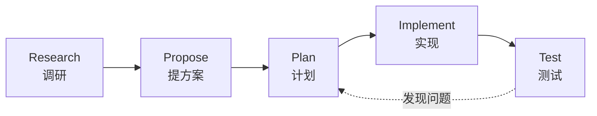

# 第 2 章　上下文工程与规格驱动开发

**中文** | [English](../en/02-context-engineering-and-spec-driven-development.md)

## 本章对应的原始材料

| 类型 | 日期 / 讲者 | 内容 | 官方链接 |
|---|---|---|---|
| 讲座 | 9/29 · Mihail Eric | 复杂代码库里的进阶提示词与上下文工程（RePPIT） | [课件](https://docs.google.com/presentation/d/17brqoQQZHF3K82WgYaV6urAV3Q7iIwyGUBYRvSuY8QY/edit) · [文字稿](https://themodernsoftware.dev/materials/9-29-26-transcript.txt) |
| 阅读 | — | The Context Tax: When to Compact | [LangWatch](https://langwatch.ai/blog/context-tax-when-to-compact) |
| 阅读 | — | OpenSpec | [openspec.dev](https://openspec.dev) |
| 阅读 | — | Superpowers | [GitHub](https://github.com/obra/superpowers) |
| 按周笔记 | 第 2 周 | 按课件顺序的原始笔记 | [附录：第 2 周笔记](../../weeks/week02/zh/notes.md) |

## 本章学习目标

1. 说清「随手提示」和「有方法地使用代理」的区别，以及后者为什么是生产代码的前提；
2. 掌握 RePPIT 五个阶段（调研、提方案、计划、实现、测试），知道每一步的产出物；
3. 理解上下文窗口里「聪明 token」和「变笨区」的概念，会判断何时清空或压缩；
4. 能根据任务规模选择委派方式：直接提示、先计划、先调研再计划、多轮循环；
5. 知道规格该放在哪里、怎么管理。

## 2.1 从第 1 章接着往下想

第 1 章的结论是：代理写得好不好，取决于它在每一步看到了什么。顺着这个结论想，问题就变成：**谁来决定它看到什么？** 如果你只丢一句「帮我加个功能」，那就是让代理自己决定：它会边猜边读文件，读到哪算哪，然后凭这些零碎信息开始写。小改动这样没问题，一旦代码库变大、功能变复杂，结果就开始不可控。

9/29 这一讲的目标，就是把这种随手提示（ad-hoc prompting）升级成一套稳健、可重复的同步开发流程：先让代理和你一起把问题弄清楚，把结论写下来，再动手。

## 2.2 Vibe coding 解决不了的问题

「Vibe coding」有很多种说法，最常见的一种是：一路按 Tab、接受 AI 给的一切、跑起来就行。这适合做原型，但课程明确说它不是本课的重点。课上抛出的问题是：如果要做一个记账应用的克隆，并且要在生产规模上扩展，你会怎么做？靠一路接受显然不行，你必须有方法地使用代理。

讲师给出的标准是：

> "You should have an active, functional mental model of how you would build your solution"
> 你应该对自己会怎么搭建这个方案，有一个活跃的、能运转的心智模型。
> —— 第 3 讲课件（9/29）

这句话的意思不是让你自己写代码，而是你脑子里得有方案的全貌：哪些模块要改、数据怎么流、哪里有风险。代理负责执行，你负责判断。课件把今天常见的坏代码分成两类：**架构决策错了**，以及**功能不正确**（往往来自模型幻觉）。前者靠事前想清楚，后者靠事后验证，这正是下面这套流程要解决的两件事。

## 2.3 RePPIT：先想清楚，再动手

RePPIT 是五个阶段的缩写，每一步都产出一份可以保存、可以审阅的文档：



**调研（Research）。** 让代理先把相关代码库整理成一份结构化的调研文档：有哪些模块、怎么组织、关键代码在哪。要点是「整理成文档」，而不是把原始代码全塞进上下文。这份文档有两个用途：作为后面几步的种子上下文；同时帮你自己快速建立心智模型。

**提方案（Propose）。** 基于调研，让代理给出大约两个方案并比较取舍。讲师的经验是超过两个收益就递减了，选项多了你反而难判断。

**计划（Plan）。** 把选中的方案写成详细计划：改哪些文件、怎么测试、要加什么日志或监控，还要**明确写出不做什么**。「不做什么」很关键，它能防止代理顺手改一堆你没要求的东西。

**实现（Implement）。** 让代理按计划写代码。有意思的是，这一步的提示词反而最简单，因为难的部分已经在前三步做完了。

**测试（Test）。** 单元测试、集成测试、冒烟测试；还可以让代理用一个审查用的 skill，从架构、风格、一致性上检查自己的改动。测试发现问题，就回到计划这一步修正，而不是在代码里打补丁。

课上的演示是给记账应用加一条「各类别消费随时间变化」的趋势线。走完调研和提方案，讲师最后选了只改前端的轻量方案。这个例子说明，RePPIT 的价值不只是写得对，还在于帮你选到**更小**的改法。

> [!NOTE]
> **补充**
> 课件也说明这套流程需要自己迭代调整。RePPIT 是一个起点，不是教条：小任务没必要五步走全，大任务可能还要多轮。

## 2.4 上下文窗口：聪明 token 和变笨区

为什么要把调研写成文档，而不是让代理一直开着对话往下聊？因为上下文窗口不是越满越好。课件给出一个经验值：上下文窗口里只有前 **二分之一到四分之三** 是「聪明」的 token。系统提示词、AGENTS.md / CLAUDE.md、任务相关内容依次占用这些空间，再往后就进入第 1 章提到的「变笨区」，模型开始抓不住重点。

由此得出几条实用做法：

- **每完成一步，就写成书面产物。** 调研文档、方案对比、计划文档，都是可以拿来开一个新会话的「干净上下文」。
- **没选中的方案要清掉。** 它们留在对话里只会浪费 token，甚至误导后面的实现。可以开新会话，或者压缩。
- **想的阶段用最强的模型，做的阶段可以轻一点。** 调研、提方案、计划需要判断力；实现和测试按计划执行，用更便宜的模型也行。
- **文档要么维护好，要么不要。** 过时的文档比没有文档更糟，它会让代理相信错误的事实。

至于什么时候压缩，本周阅读 The Context Tax 讨论了成本和效果的平衡，课上引用的结论是大约在 25 万到 45 万 token 之间压缩比较合适，但具体数字因模型而异。重点不是记住数字，而是养成习惯：时刻知道你的上下文里装了什么。

## 2.5 什么任务用什么方式

不是所有任务都值得走完整流程。课件列了四种委派方式，按投入从小到大：

| 方式 | 适合的任务 | 例子 |
|---|---|---|
| 直接提示 | 小而明确，改错了也容易发现 | 改一个文案、修一个拼写 |
| 先做计划 | 涉及几个文件，但你已经熟悉代码 | 给现有接口加一个参数 |
| 先调研再计划 | 不熟悉的代码库，或者影响范围不清楚 | 在陌生项目里加新功能 |
| 多轮「调研→计划」 | 大功能，需要拆成多个子任务 | 重构一个模块、做一次迁移 |

大功能的标准做法是：先拆成任务清单，每完成一项就把结果写成文档，下一项从这份文档出发。这样每一项都在干净的上下文里完成，不会越做越糊涂。

## 2.6 动手看：一份够用的计划文档

下面是我们自己写的一个计划模板，结构照 RePPIT 的要求组织。重要的不是格式，而是每一栏都逼你把一个问题想清楚：

```markdown
# 计划：消费趋势图（只改前端）

## 背景
见 research.md 第 2 节：交易数据已按类别和日期返回，无需改后端。

## 选定方案
方案 A（前端聚合）。放弃方案 B（新增后端接口），理由：数据量小，B 改动面大。

## 改动文件
- src/charts/TrendChart.tsx（新建）
- src/pages/Dashboard.tsx（挂载图表）

## 测试
- 单元：按月聚合函数，覆盖空数据、跨年
- 冒烟：本地打开仪表盘，图表显示 3 个类别

## 不做什么
- 不改 API，不改数据库
- 不调整现有图表样式
```

把这份计划交给代理实现，你会发现提示词只需要一句：「按 plan.md 实现，完成后跑测试」。

## 2.7 其他规格驱动框架

RePPIT 不是唯一的做法。本周阅读介绍了两个流行框架，可以对比着看：

- **Superpowers**：一套有主见的、端到端的引导式流程，基于测试驱动开发（TDD），由一组 skills 组成，分别负责写规格和计划、实现、测试，并内置并行。
- **OpenSpec**：更轻量。它把规格当作「唯一事实来源」保存在仓库里，每次变更先写一份变更规格，实现后再合并回总规格。

规格放在哪？可以放在 Linear 这类任务系统里，也可以像 OpenSpec 那样放在本地并纳入 Git。课上还建议，代码库各部分的设计取舍和决策可以记在 `.notes/` 这样的目录里，以后的代理和人都能查到。

> [!NOTE]
> **补充**
> 规格放进 Git 有个额外好处：它和代码一起被审阅、一起回滚。第 6 章讲代码审查时，审查者可以对照规格判断改动是否越界。

## 相关视频

- [CS146S 每周速览播放列表](https://www.youtube.com/playlist?list=PLxpwjSdVZQ97L8hAGqTYUeOJqnKVSu3pb)：粉丝 AI With Ryan 制作，非官方，内容是 2025 年秋季那一期的总结，可作预习。
- 9/29 课堂录像：官网暂未发布。

## 动手练习

1. 选你自己的一个项目，挑一个需要改两三个文件的小功能；
2. 按 RePPIT 走一遍，保存 research.md、proposal.md、plan.md 三份文档；
3. 实现阶段开一个新会话，只给代理 plan.md，看它能不能独立完成；
4. 回顾：哪一份文档最有用？哪一步可以省掉？

## 自查

- [ ] 能说出 RePPIT 五个阶段和各自的产出物
- [ ] 能解释为什么计划里要写「不做什么」
- [ ] 能说出「聪明 token」大约占上下文窗口多少，以及超过之后会怎样
- [ ] 能为四种委派方式各举一个合适的任务
- [ ] 能说出 Superpowers 和 OpenSpec 各自的特点

## 下一章预告

到目前为止，代理能用的工具只有读写文件这几样。可真实的开发还要查文档、看工单、读数据库、操作浏览器。怎样把这些外部能力接给代理，又不让工具描述塞满上下文？第 3 章「工具与能力：MCP 和 Skills」回答这个问题。
