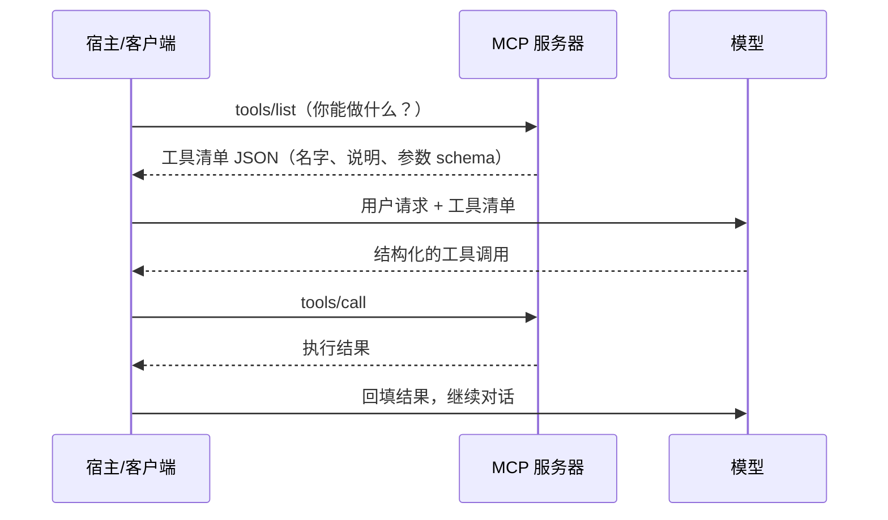

# 第 3 章　工具与能力：MCP 和 Skills

**中文** | [English](../en/03-tools-and-capabilities-mcp-and-skills.md)

## 本章对应的原始材料

| 类型 | 日期 / 讲者 | 内容 | 官方链接 |
|---|---|---|---|
| 讲座 | 10/1 · Mihail Eric | MCP、工具调用及更多 | [课件](https://docs.google.com/presentation/d/1q2cB1a7P4XsR0UJqE0RmtZFeggNOLdPaSnOpbBVewHA/edit) · [文字稿](https://themodernsoftware.dev/materials/10-1-26-transcript.txt) · [Skills 文件夹](https://drive.google.com/drive/folders/1aEHCXzZKkokuA4AYjD_2i6OrcM5iQosW) |
| 讲座 | 10/6 · Mihail Eric | Agent Skills | [课件](https://docs.google.com/presentation/d/15bPu5c-i8D8McTh6l7SpUPk2n9M_Y-CdDQLfyzL8RD8/edit) |
| 嘉宾 | 10/8 · Lee Robinson | 常驻代理是怎么工作的 | [课件](https://drive.google.com/file/d/1b8WiBk_lcB3ue-jZMLijSUMLj6SDiF6Z/view)（标注保密，本章只概括公开要点） · [公开视频（X）](https://x.com/leerob/status/2108650243365736855) |
| 阅读 | — | Enterprise MCP（Cloudflare） | [Cloudflare 博客](https://blog.cloudflare.com/enterprise-mcp) |
| 阅读 | — | pstack · Matt Pocock's Skills · browse.sh | [pstack](https://github.com/cursor/plugins/tree/main/pstack) · [skills](https://github.com/mattpocock/skills) · [browse.sh](https://browse.sh) |
| 标准 | — | MCP 规范 · Agent Skills 标准 | [modelcontextprotocol.io](https://modelcontextprotocol.io) · [agentskills.io](https://agentskills.io/home) |
| 按周笔记 | 第 2、3 周 | 原始笔记 | [第 2 周](../../weeks/week02/zh/notes.md) · [第 3 周](../../weeks/week03/zh/notes.md) |

## 本章学习目标

1. 说清为什么代理需要接入「动态数据」，以及 MCP 解决了什么问题；
2. 讲出 MCP 的四个角色（宿主、客户端、服务器、工具）和一次调用的完整流程；
3. 会设计一个好的 MCP 服务器：面向结果、参数明确、描述即提示词；
4. 理解 skill 是什么、为什么按需加载，能写出一个合格的 skill；
5. 能在 API、MCP、Skill、命令行之间做出选择。

## 3.1 模型知道很多，但都是旧的

大模型拥有海量的世界知识，但这些知识是**静态**的：停在训练截止的那一天，只有重新训练才会更新。可开发中真正需要的信息几乎都是动态的：今天的工单、刚上线的报错、数据库里的最新数据、某个库刚发布的新版本文档。

第 1 章已经给出解法：工具。代理需要什么，就给它一个能去拿的工具。问题在于规模。假设有 M 个代理产品（Cursor、Claude Code……）和 N 个外部服务（GitHub、Jira、Notion……），如果每对都要单独写连接器，就是 M × N 个，每个还要各自处理认证、错误、限流。这显然不可持续。

## 3.2 MCP：给工具定一个统一插头

**MCP（Model Context Protocol，模型上下文协议）** 是一个开放协议，用一种通用格式让各种系统为 AI 模型提供上下文。课件的说法更直接：

> "In English: standard format for exposing tools to LLMs"
> 说白了：向大模型暴露工具的标准格式。
> —— 第 4 讲课件（10/1）

有了统一格式，每个代理只需实现一次 MCP 客户端，每个服务只需提供一个 MCP 服务器，连接器数量从 M × N 变成 M + N。消息格式统一用 JSON-RPC，传输方式有本地的 stdio 和远程的 streamable HTTP 两种。

MCP 里有四个角色：

| 角色 | 是什么 | 例子 |
|---|---|---|
| 宿主（Host） | 用户使用的代理应用 | Cursor、Claude Desktop |
| 客户端（Client） | 嵌在宿主里的库，每个服务器对应一个有状态会话 | — |
| 服务器（Server） | 包在某个服务前面的轻量封装 | GitHub MCP、Notion MCP |
| 工具（Tool） | 服务器提供的可调用函数 | `create_issue`、`search_pages` |

一次完整调用是这样的：



和第 1 章对照一下就会发现：这就是那个代理循环，只是「工具」不再是写死在程序里的三个函数，而是可以从任何 MCP 服务器动态取来。

## 3.3 好的 MCP 服务器不是 API 的翻版

最常见的错误，是把一个 REST API 的每个端点一对一包成一个工具。课上解释了为什么不行：API 端点是为人类程序员设计的，未必是模型消费信息的最佳方式。一对一映射会带来三个问题：小工具太多；工具描述把上下文撑得又大又杂；代理把大量步骤花在编排调用顺序上。

课件给出的最佳实践：

- **面向结果，而不是面向操作。** 要转账，就提供一个 `send_payment(user_email)`，而不是让代理先 `get_users`、再 `list_account`、再 `send_payment(account_id)` 地拼三步。
- **参数明确。** 不要用嵌套字典当输入，模型容易填错。
- **说明就是上下文。** 文档字符串、报错信息都是提示词，写清楚它们，模型才会正确使用和纠错。这和第 1 章 `edit_file` 返回错误信息的思路一致。
- **命名便于发现。** 工具名加服务前缀，比如 `linear_create_issue`，多个服务器同时接入时不会混淆。

当 MCP 服务器多到几十个时，还有一种更激进的设计：只暴露两个工具，**search** 和 **execute**。代理先用 search 找到需要的工具定义，再让 execute 运行一段确定性的代码完成操作。这样上下文大小不再随服务器数量增长，课件给出的数字是 token 减少 90% 以上。课件的例子是「找到一张 Jira 工单，用 Google Drive 里的信息更新它」：复杂的跨服务逻辑在代码里一步完成，数据在到达模型之前就已被过滤。

> [!NOTE]
> **补充**
> 企业里还要考虑管控。本周阅读 Cloudflare 的做法是建一个 MCP 门户：员工只连门户，门户按权限列出可用的内部和第三方服务器，并统一记录日志、执行策略、防止数据泄露。

## 3.4 Skills：写给代理的操作手册

MCP 解决「能做什么」，但还有一类知识它管不了：「这件事应该怎么做」。比如你们团队的代码审查要看哪几点、发版前要跑哪些检查、写技术文档用什么结构。这些是**流程**，不是工具。

大模型恰好非常擅长遵循较长的流程说明。**Agent Skills** 就是把这种能力标准化：一个 skill 是一个文件夹，核心是一份 Markdown 写的流程说明，可以附带脚本和参考文件。课件形容它「就像给代理用的脚本」。

Skill 最关键的设计是**按需加载**：会话开始时，代理只看到每个 skill 的名字和一句描述；判断某个 skill 和当前任务相关时，才读入完整内容。所以装一百个 skill 也不会塞满上下文。这和第 1 章表格里「常驻」与「按需」的区分是同一个思路。

一个 skill 的骨架大致如下（我们自己写的示例）：

```markdown
---
name: release-check
description: 发版前检查。用户说「准备发版」「打 tag」「release」时使用。
---
1. 运行 `npm test`，有失败就停下并报告。
2. 运行 `npm run lint`，自动修复能修的部分。
3. 检查 CHANGELOG.md 是否有本次版本的条目，没有就起草一条给用户确认。
4. 列出自上个 tag 以来的提交，按功能 / 修复分组。
详细的版本号规则见 references/versioning.md（需要时再读）。
```

注意最后一行：细节放在单独文件里，用到才读，这就是课件说的**渐进式披露**。

## 3.5 写好 skill 的八条经验

10/6 这一讲的课件总结了一组最佳实践，可以归成三类：

**范围与来源。** 一个 skill 只做一件定义清楚的任务。最好的 skill 来源是你自己的对话记录：翻翻看你在哪些地方反复纠正过代理，那些纠正写下来就是 skill。还要维护自己的 skill 合集，随身带到不同项目。

> "Chefs bring their own knives between kitchens"
> 厨师换厨房，也带着自己的刀。
> —— 第 5 讲课件（10/6，引用 poteto）

**触发与结构。** 在描述里写清触发场景和用户可能的说法，代理才知道何时用它；用渐进式披露控制长度；做成模块化、可以互相组合的小单元。

**省力与闭环。** 能用现成命令行工具做的事，就给代理一个 CLI，再用 skill 把样板操作包起来，别让代理花 token 重复造轮子。另外保留一个**验证 skill**，让代理检查自己的产出，形成改进闭环。

课件还把 skill 分成几类：代码理解与规划（比如 RePPIT 系列、让代理反复追问你需求的 grill-me）、验证、代码风格（适合审查代理），以及网页解析等其他用途。

## 3.6 API、MCP、Skill、命令行怎么选

| | API | MCP | Skill |
|---|---|---|---|
| 是什么 | 应用暴露给开发者的服务接口 | 以标准方式暴露给代理的工具定义 | 教代理如何完成一项工作的流程包 |
| 谁来用 | 你，或 SDK | 代理运行时 | 代理，作为更高层的能力 |
| 解决什么 | 程序之间的通信 | 代理接入外部服务和数据 | 可重复的做事方法 |

一个简单的判断顺序：需要访问外部系统且涉及认证、权限，用 MCP；本地已有成熟的命令行工具，直接让代理用 CLI；需要固定的做事步骤，写 skill，必要时在 skill 里调用 MCP 或 CLI。第 4 章的阅读材料里还有一篇「我还是更喜欢 MCP」的反方观点，可以对照着看。

## 嘉宾专栏：Lee Robinson，常驻代理是怎么工作的（10/8）

> [!NOTE]
> **补充**
> 这一讲的课件标注了保密和前瞻性声明，这里只用我们自己的话概括思路，不引用原文。
>
> 第 1 章写的代理，关掉终端就停了。常驻代理则运行在服务器上，有自己的云端电脑，保存状态、记忆和 skills，由事件唤醒（你的消息、定时任务、聊天工具里的提及等），可以持续工作很久。
>
> 人和 AI 协作的方式也在演进：从复制粘贴聊天，到终端里每步由你批准，再到多个代理在后台并行、你只审最终结果，最后是给一个「有自己电脑和记忆的同事」发消息。你的角色从逐步批准变成随时纠偏。
>
> 和本章最相关的一点：记忆和 skills 都以纯文本文件保存，人和代理都能读、能改，skill 只在需要时加载，所以多也不贵。架构上则强调状态存在服务器、每一步可以安全重试。这些内容在第 8 章「后台代理」会展开。
>
> 来源：课件（标注保密，不引用原文）；公开视频为 Lee Robinson 本人发在 X 上的讲座，不是课程官网：<https://x.com/leerob/status/2108650243365736855>。

## 相关视频

- [CS146S 每周速览播放列表](https://www.youtube.com/playlist?list=PLxpwjSdVZQ97L8hAGqTYUeOJqnKVSu3pb)：粉丝制作，非官方，2025 年秋季那一期的总结。
- [10/8 Lee Robinson 嘉宾讲座公开视频](https://x.com/leerob/status/2108650243365736855)（他本人发在 X 上，不是课程官网）。
- 10/1、10/6 课堂录像：官网暂未发布。

## 动手练习

1. 写一个只有 2–3 个「面向结果」工具的小 MCP 服务器（比如查天气并给出穿衣建议），接到你常用的代理里；
2. 翻你最近一周和代理的对话，找出一处你反复纠正它的地方，写成一个 skill；
3. 给这个 skill 写清触发说法，新开会话测试代理会不会在合适的时候自动用它；
4. 对比：同一件事分别用 MCP、CLI、skill 实现，各自的上下文占用和稳定性有什么不同。

## 自查

- [ ] 能解释 M × N 到 M + N 的含义
- [ ] 能画出一次 MCP 调用的流程
- [ ] 能说出为什么不该把 REST API 一对一包成 MCP 工具
- [ ] 能解释 search + execute 设计为什么能省 token
- [ ] 能说出 skill 按需加载的机制和渐进式披露的含义
- [ ] 遇到一个新需求，能判断该用 MCP、CLI 还是 skill

## 下一章预告

工具和流程都有了，但还缺一样：代理对**你这个项目**的了解。用什么构建工具、代码风格是什么、哪些地方不能碰，这些需要写下来常驻在它的上下文里。第 4 章「定制你的代理」讲 AGENTS.md、hooks 和子代理。
