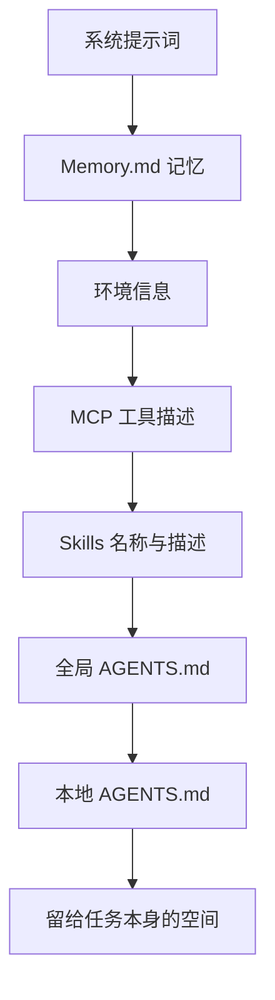

# 第 4 章　定制你的代理

**中文** | [English](../en/04-customizing-your-agent.md)

## 本章对应的原始材料

| 类型 | 日期 / 讲者 | 内容 | 官方链接 |
|---|---|---|---|
| 讲座 | 10/13 · Mihail Eric | 定制你的代理环境 | [课件](https://docs.google.com/presentation/d/152VaUifBKH4T6hxd6fCKKM9kJTSAuBmkF8zSYwuTYAo/edit) |
| 嘉宾 | 10/15 · Boris Cherny（Claude Code） | 嘉宾讲座 | 官网暂未发布材料 |
| 课上示例 | — | Next.js 的 AGENTS.md | [GitHub](https://github.com/vercel/next.js/blob/canary/AGENTS.md) |
| 阅读 | — | I Still Prefer MCP Over Skills | [david.coffee](https://david.coffee/i-still-prefer-mcp-over-skills) |
| 阅读 | — | AGENTS.md（Factory 文档） | [Factory](https://docs.factory.com/harness/agents-md) |
| 阅读 | — | Steering Claude Code | [claude.com](https://claude.com/resources/articles/steering-claude-code-skills-hooks-rules-subagents-and-more) |
| 阅读 | — | Writing a Good CLAUDE.md | [hlyr.dev](https://hlyr.dev/blog/writing-a-good-claude-md) |
| 按周笔记 | 第 4 周 | 原始笔记 | [附录：第 4 周笔记](../../weeks/week04/zh/notes.md) |

## 本章学习目标

1. 说出定制代理的四种主要手段：配置文件、hooks、skills、子代理，以及各自适合做什么；
2. 写出一份结构清楚、不超过 300 行的 AGENTS.md / CLAUDE.md；
3. 理解 hooks 是「确定性」的，知道它什么时候比提示词更可靠；
4. 会用子代理把旁支任务的上下文隔离出去；
5. 能画出一次会话里上下文的分层结构，并评估它的预算。

## 4.1 为什么要定制

前三章讲的都是通用能力：循环、工具、流程。可每个项目都有自己的脾气：这个项目用 maven 不用 gradle，那个项目的测试必须加某个参数，某个目录是生成的、绝对不能手改。这些信息模型不可能事先知道，如果每次都靠你在对话里提醒，既累又容易忘。

课件的说法是：想用编程代理达到最高效率，就得**掌控自己的技术栈**。好在现代框架提供了很多定制手段，本章按「从常驻到按需、从软约束到硬约束」的顺序逐一讲。


## 4.2 AGENTS.md：写给代理看的 README

> "README for agent"
> 写给代理看的 README。
> —— 第 7 讲课件（10/13）

AGENTS.md（Claude Code 里叫 CLAUDE.md，原理相同）放在仓库里，每次会话开始时自动加载进上下文，而且优先级很高。课件建议的结构有六部分：

1. **项目概览**：一张代码库地图，哪个目录放什么；
2. **构建与测试命令**：比如「用 maven 而不是 gradle」；
3. **代码风格**；
4. **测试说明**；
5. **安全注意事项**；
6. **技术栈的特殊陷阱**：比如「这是 React 18 + TypeScript，用 Vite 构建」。

比结构更重要的是写法原则：

- **普遍适用。** 只写每次会话都需要的信息。某个功能专用的说明，应该放到 skill 或子目录文档里。
- **避免代码片段。** 代码很快过时，过时的示例会误导代理，比没有更糟。这和第 2 章「过时文档不如没有」是同一条道理。
- **控制长度。** 课件建议少于 300 行。它是常驻上下文，每多一行都在挤占「聪明 token」。
- **大仓库用嵌套。** 根目录的 AGENTS.md 当路由，写一句「API 网关的细节见 docs/API-GATEWAY.md」，代理需要时再去读。

CLAUDE.md 支持从根目录一路加载到离当前文件最近的那一份，所以越具体的指令越晚被模型读到。这样不同服务或团队的目录可以各有约定。课上拿 Next.js 仓库的 AGENTS.md 当真实例子，值得打开读一遍。

下面是一个我们自己写的精简示例：

```markdown
# AGENTS.md
## 项目地图
- web/：前端（React 18 + TypeScript，Vite 构建）
- api/：后端（FastAPI）
- docs/：设计文档，改架构前先读 docs/ARCHITECTURE.md

## 命令
- 安装：make setup　　测试：make test　　格式化：make fmt

## 约定
- 新接口必须有单元测试
- 不要手改 api/generated/ 下的文件，它们由 make gen 生成

## 安全
- 不要提交 .env；密钥只从环境变量读取
```

## 4.3 Hooks：用代码兜底

AGENTS.md 是写给模型「看」的，模型大多数时候会照做，但不保证。有些事情你需要百分之百发生，这时就该用 **hooks**。

Hook 是在固定事件上运行的**确定性脚本**，比如：

| 事件 | 时机 | 典型用途 |
|---|---|---|
| `UserPromptSubmit` | 用户提交提示词时 | 清洗或补充提示词 |
| `PreToolUse` | 工具执行之前 | 拦截危险命令、保护敏感文件 |
| `PostToolUse` | 工具执行之后 | 改完代码自动跑格式化或 linter |
| `PreCompact` | 压缩上下文之前 | 先把关键信息存档 |

关键区别在于：提示词是「请你这样做」，hook 是「一定会这样做」。比如你希望每次改完都格式化，写在 AGENTS.md 里可能会被忘，写成 `PostToolUse` hook 就绝不会漏。Claude Code 和 Cursor 都支持 hooks。

> [!NOTE]
> **补充**
> 一个经验法则：如果某条规则被违反时你会生气，就别只写在提示词里，写成 hook 或 CI 检查。

## 4.4 Skills 与子代理：按需的能力和隔离的上下文

**Skills** 上一章已经详细讲过。在定制这个语境下，它的角色是把你常用的提示词做成文件：跑测试、写计划、做调研、审查代码、验证产出。课上举的例子有 Claude Code 里的「ship-it」发版命令和 Cursor 的「deslop」清理命令。

**子代理（subagents）** 解决的是另一个问题：上下文污染。假设你正在实现一个功能，中途需要搞清楚某个陌生模块怎么用。如果在主对话里探索，读进来的大量代码会一直留在上下文里。更好的做法是派一个子代理去探索：它在全新的上下文里工作，最后只交回一段结论。

子代理的名字、描述和工具列表在会话开始时加载，可以由代理自动调用，也可以由你明确指定。课件列出的典型用途有：探索和理解代码库、改完后简化代码、端到端测试应用。它**特别适合旁支任务**。

和 AGENTS.md 对比：AGENTS.md 用来锚定代理的整体行为；子代理用来把某一类工作外包出去，不让它弄脏主线。

## 4.5 MCP 的定制价值

第 3 章讲了 MCP 的原理，这一讲补充了它在定制中的好处：认证无缝、版本更新方便、在不同客户端之间可移植，而且远程 MCP 天然把能力隔离在沙箱里。课件还按场景列了常见的 MCP：

| 类型 | 例子 | 用途 |
|---|---|---|
| 项目管理 | Jira、Linear | 读取工单并开始任务，创建和更新工单 |
| 文档 | Notion、Confluence | 从功能规格生成工单 |
| 可观测性 | Datadog、Sentry | 实时排查线上问题 |
| 数据库 | Redshift | 排查数据问题，了解数据结构 |
| 技术文档 | Context7 | 用最新的库文档，减少幻觉 |
| 实验追踪 | Arize | 根据测试结果建议新实验 |

## 4.6 把所有层叠起来：上下文的组成

最后，把本章和前几章的所有东西放在一起，一次会话开始时代理的上下文大致按这个顺序叠起来：



每加一层，留给任务本身的空间就少一点。回想第 2 章的经验值：只有前二分之一到四分之三是「聪明」的。所以定制的目标不是「什么都写进去」，而是**用最少的常驻内容换最大的效果**，其余的交给按需加载。

## 嘉宾专栏：Boris Cherny（10/15）

> [!NOTE]
> **补充**
> Boris Cherny 是 Claude Code 的创造者之一。这一讲官网暂未发布课件和文字稿，材料公开后补充。课件第 7 讲在讲 hooks 时引用过他在 X 上分享的配置示例，可以先从那里了解他的用法。

## 相关视频

- [CS146S 每周速览播放列表](https://www.youtube.com/playlist?list=PLxpwjSdVZQ97L8hAGqTYUeOJqnKVSu3pb)：粉丝制作，非官方，2025 年秋季那一期的总结。
- 10/13、10/15 课堂录像：官网暂未发布。

## 动手练习

1. 按 4.2 节的六段结构，为你自己的一个项目重写 AGENTS.md 或 CLAUDE.md，控制在 300 行以内；
2. 加一个 `PostToolUse` hook：每次改完代码自动运行格式化或测试；
3. 加一个 `PreToolUse` hook：禁止代理修改 `.env` 或生成目录；
4. 试一次子代理分工：一个负责探索代码库并写摘要，主代理只根据摘要实现功能。比较主对话的上下文长度。

## 自查

- [ ] 能说出 AGENTS.md 的六部分结构和四条写法原则
- [ ] 能解释为什么不要在 AGENTS.md 里放代码片段
- [ ] 能说出提示词和 hook 的本质区别
- [ ] 能举出两个适合用子代理的旁支任务
- [ ] 能画出上下文的分层顺序，并说明为什么要控制常驻内容

## 下一章预告

到这里，我们一直在调整代理这一侧：给它工具、流程和项目说明。但还有另一侧：代码库本身。测试不全、构建不稳、文档过时的仓库，再好的代理也会频频出错。第 5 章「让代码库适合代理」换个方向，从仓库入手。
