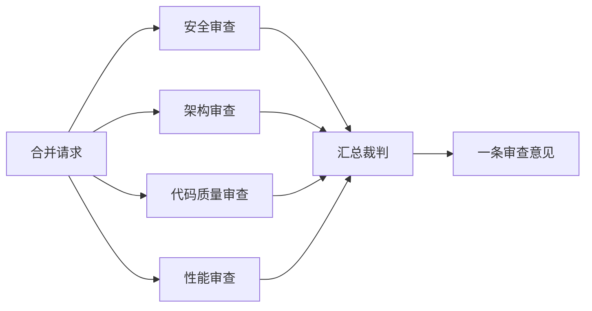

# 第 6 章　代理代码审查

**中文** | [English](../en/06-agentic-code-review.md)

## 本章对应的原始材料

| 类型 | 日期 / 讲者 | 内容 | 官方链接 |
|---|---|---|---|
| 讲座 | 10/27 · Mihail Eric | 代理代码审查：最佳实践与架构 | [课件](https://docs.google.com/presentation/d/1u8WYtFj0O9yc4H4JX9D4URYKhDzvrAGKLzn38DXSrak/edit) |
| 嘉宾 | 10/29 · Silas Alberti（Cognition 首席研究官） | 嘉宾讲座 | 官网暂未发布材料 |
| 阅读 | — | Layered Code Review and Risk-Based Human Oversight | [X](https://x.com/addyosmani/status/2114604912520921136) |
| 阅读 | — | Coordinating Specialist Review Agents at Scale | [Cloudflare](https://blog.cloudflare.com/ai-code-review) |
| 阅读 | — | Beyond the Diff: Context, Testing, and Model Selection | [Greptile](https://greptile.com/blog/how-to-build-a-code-review-agent) |
| 按周笔记 | 第 6 周 | 原始笔记 | [附录：第 6 周笔记](../../weeks/week06/zh/notes.md) |

## 本章学习目标

1. 说清代码审查的两个作用，以及它为什么成了 AI 时代的新瓶颈；
2. 理解 AI 审查的成熟度阶梯：从人工全审到多代理分级审查；
3. 能画出一个多代理审查架构，并解释汇总裁判的作用；
4. 掌握设计审查代理的几条原则：换模型、给上下文、真的跑起来、控成本、做评估；
5. 知道 AI 审查目前还不擅长什么，人应该在哪里把关。

## 6.1 审查为什么重要，又为什么成了瓶颈

课件开门见山：代码审查是提升个人水平和团队代码质量杠杆最高的事情之一。它做两件事，一是在上线前发现并修掉 bug，二是让整个团队对系统保持一致的理解。代码在变，每个人脑子里的系统图也得跟着变，审查就是同步的过程。

审查能发现的问题，课件列了五类：逻辑和正确性、可读性和可维护性、性能、安全，以及团队里口口相传的最佳实践。

问题在于速度。前五章我们一直在让代理写得更快、更多，但审查还是人一行行地看。课件的判断是：**审查已经成了新的瓶颈**。Cloudflare 的文章也提到，在他们内部，一个合并请求等到第一次审查，常常要以小时计。

## 6.2 成熟度阶梯

课件把 AI 时代的审查分成三级：

| 阶段 | 做法 | 问题或优势 |
|---|---|---|
| 第 0 级 | 人审查所有改动 | 没法扩展 |
| 第 1 级 | 一个代理审查 | 配上「发现问题—自动修复」的循环会更好，但效果还没吃满 |
| 第 2 级 | 多代理、按风险分级审查，内置自我改进 | 很多公司正在收敛到这种做法 |

第 2 级有一个细节值得注意：团队的工程规范被存进 skill 知识库（第 3、4 章）。审查代理不靠一句万能提示词，而是读团队自己写下的规矩。

## 6.3 多代理审查架构



一个 PR 同时派给几个专门的审查代理，每个只管一个方面，最后由汇总裁判合并结论。课件用的例子是 Cloudflare。根据他们公开的文章，这套系统最多同时派出七个审查代理（安全、性能、代码质量、文档、发布管理、内部规范合规等），由一个协调代理去重、重新归类、过滤掉臆测和吹毛求疵，再给出是否通过的决定。

文章里有几个做法很值得借鉴：

- **写清「不要报什么」**：比如安全审查只报真正能被利用的问题，不报需要极端前提的理论风险。文章认为，提示词真正的价值在于告诉模型哪些不要做；
- **严重等级**：每条发现标成严重、警告或建议，只有严重问题才阻止合并；
- **按风险分级派人**：改个错字不需要七个代理。改动小就只派两个，碰到认证、加密等敏感目录就一定全套审查；
- **人工强制通过**：紧急修复时，人可以一句话放行。

下面是我们按这个思路写的一个极简分级函数，只为说明思路，阈值是随手取的，不是任何公司的真实配置：

```python
def risk_tier(files_changed: int, lines_changed: int, touches_sensitive: bool) -> str:
    """按改动规模和敏感路径决定派几个审查代理（示意）。"""
    if touches_sensitive or files_changed > 50:
        return "full"      # 全部专门审查代理
    if lines_changed <= 10:
        return "trivial"   # 协调者 + 一个通用审查
    if lines_changed <= 100:
        return "lite"      # 再加代码质量、文档
    return "full"
```

## 6.4 设计一个审查代理

课件的这一部分参考了 Greptile 的文章。那篇文章的思路是：一个最简单的审查代理一天就能搭出来，接 GitHub 的 webhook，读 diff，发评论。但它会漏很多 bug、看不懂代码库、很贵、评论琐碎，每跑一次还冒出新问题。然后一项项改进：

1. **换模型（模型反转）**：写代码和审代码用同一家的模型，盲点也一样。课件称之为 model inverter：Claude 写的代码让 GPT 审，反过来也一样。Greptile 称这样做能多抓到约 10% 的 bug；
2. **给足上下文**：只看 diff 会漏掉连锁影响，比如权限绕过。要给代理接上文档、任务系统，最好再有一份代码库的索引或 wiki，记下过去的事故和回滚；
3. **真的跑起来**：起一个开发容器，装好依赖、启动服务，用浏览器点一遍，比让模型干看代码可靠；
4. **按任务选模型**：课件给的分法是，收集代码上下文用便宜快的模型，浏览器操作用中小模型配高推理，深度找 bug 才用最强模型；
5. **评估**：真正的 bug 很少，评估很难。课件建议用历史上含已知 bug 的 PR，以及引发过回滚的事故做测试集。

> [!NOTE]
> **补充**
> 这几条和前面几章是一条线：第 1 章说代理的上限取决于它能看到和验证的东西，审查代理也一样；第 5 章的代理就绪清单（测试、可复现构建）就是「真的跑起来」的前提。

## 6.5 可选工具

课件列了两组：通用审查有 Claude Code、Greptile、CodeRabbit、Devin；偏安全的有 Vercel deepsec、Wiz、Semgrep。第 7 章讲安全时，Semgrep 的 CEO 会来做嘉宾讲座。

## 6.6 AI 审查还做不好什么

Cloudflare 的文章坦白列了局限，可以当作人该把关的清单：

- **架构**：代理看到 diff 和周围的代码，但不知道系统为什么这样设计，也判断不了改动方向对不对；
- **跨系统影响**：改了接口约定，它能提醒，但没法确认所有下游都改了；
- **并发问题**：依赖时序的竞态条件很难从静态 diff 里看出来；
- **成本随改动变大**：几百个文件的重构，审一次就很贵。

所以 AI 审查目前不是替代人，而是让人把注意力放在真正有风险的地方。

## 嘉宾专栏：Silas Alberti（Cognition 首席研究官，10/29）

> [!NOTE]
> **补充**
> 这一讲官网暂未发布材料。Cognition 是 Devin 的开发公司，Devin 也出现在本讲的工具清单里。材料公开后，我们会补充这一讲的内容。

## 动手练习

1. 挑一个自己的 PR，用两家不同厂商的模型各审一次，比较它们发现的问题有什么不同；
2. 给审查提示词加一段「不要报什么」，再审一次，看评论数量和质量的变化；
3. 参考 6.3 节的分级函数，为自己的仓库定义一份敏感目录清单；
4. 从仓库历史里找一个修过 bug 的提交，把修复前的版本交给审查代理，看它能不能发现。

## 自查

- [ ] 能说出代码审查的两个作用和五类能发现的问题
- [ ] 能说出成熟度阶梯的三个阶段
- [ ] 能画出多代理审查架构，并说明汇总裁判做什么
- [ ] 能解释什么是模型反转，以及它为什么有用
- [ ] 能举出至少两项 AI 审查目前的局限

## 下一章预告

审查代理里，安全审查最特殊：漏一个问题，代价可能远大于一个普通 bug。第 7 章「AI 代码库的安全」将在 11/3 的课后更新。
