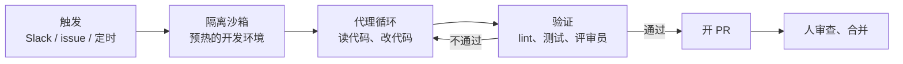

# 第 8 章　后台代理

**中文** | [English](../en/08-background-agents.md)

## 本章对应的原始材料

| 类型 | 日期 / 讲者 | 内容 | 官方链接 |
|---|---|---|---|
| 讲座 | 11/10 · Mihail Eric | 后台代理：异步启动任务 | [课件](https://docs.google.com/presentation/d/1R8Pr3RNAFQiw8mHKbXopOhxi_h9zuEeUKrJkxCZ5Fio/edit) |
| 嘉宾 | 11/12 · Rajesh Bhatia（Cloudflare 高级总监） | 嘉宾讲座 | 官网暂未发布材料 |
| 阅读 | Spotify | From Migration Scripts to Agent Fleets（Honk 第 1 部分） | [Spotify Engineering](https://engineering.atspotify.com/2025/11/spotifys-background-coding-agent-part-1) |
| 阅读 | Stripe | From Slack Message to Review-Ready PR（Minions） | [stripe.dev](https://stripe.dev/blog/minions-stripes-one-shot-end-to-end-coding-agents) |
| 阅读 | Ramp | Giving Agents the Tools to Prove Their Work（Inspect） | [Ramp Builders](https://builders.ramp.com/post/why-we-built-our-background-agent) |
| 阅读 | LangChain | Inside an Open-Source Software Factory（open-swe） | [GitHub](https://github.com/langchain-ai/open-swe) |
| 课件引用 | Walden Yan（Cognition） | Multi-Agents: What's Actually Working | [X](https://x.com/walden_yan/status/2047054401341370639) |
| 补充阅读 | Spotify | Predictable Results Through Strong Feedback Loops（Honk 第 3 部分） | [Spotify Engineering](https://engineering.atspotify.com/2025/12/feedback-loops-background-coding-agents-part-3) |
| 相关视频 | Rajesh Bhatia | Cloudflare's AI Engineering Stack: Assisted to Delegated | [YouTube](https://www.youtube.com/watch?v=MbLdrAZFQRs) |
| 按周笔记 | 第 8 周 | 原始笔记 | [附录：第 8 周笔记](../../weeks/week08/zh/notes.md) |

## 本章学习目标

1. 说清后台代理和第 1–7 章里「坐在终端前陪着代理干活」的区别，以及它为什么能带来并行；
2. 能用五个问题拆解一个后台代理平台：在哪跑、任务从哪来、能拿到什么、怎么证明做对了、做完交给谁；
3. 理解验证循环为什么是后台代理的核心，能说出 Spotify 的三种失败方式；
4. 认识三种多代理模式，知道为什么现在能用的多代理大多是「一个代理写、其他代理出主意」；
5. 知道衡量一个后台代理平台该看什么指标。

## 8.1 从「陪着写」到「派出去」

前七章里的代理大多是同步的：你在终端里提一个要求，看着它读文件、改代码、跑测试，中途随时插话。这种方式的上限是人的注意力，同一时间你只能盯一个会话。

课件把编程代理的能力分成三个阶段：2021 年的 Tab 补全，效率提升约 15%；2024 年的同步单任务，约 25–35%；2026 年开始的后台多任务，目标是 2 倍以上。前两个阶段是让人写得更快，第三个阶段换了一种思路：人不再盯着每个任务，而是一次派出好几个，让它们在别处各自跑完，再回来看结果。

这件事第 6 章已经见过一次。审查代理在 PR 打开时自动触发，没有人去启动它。本章把这个思路推广到写代码本身：从一条 Slack 消息、一个 issue 或一个定时任务出发，到一个可以审查的 PR 结束。

> "Spawning multiple concurrent tasks in asynchronous contexts → massive parallelism"
> 在异步环境中同时派出多个任务，换来大规模并行。
> —— 第 15 讲课件（11/10）

要做到这一点，代理就不能再跑在你的笔记本上。课件把这叫作「本地开发环境的终结」：环境在云端统一构建，不再有「在我电脑上能跑」的问题；每次都一样，可以复现；测试在专用机器上跑；要并行多少个，就开多少个。

## 8.2 拆解一个后台代理平台

课件对后台代理平台的定义是：接到一个任务，拉起一个接近生产的开发环境，端到端跑完整个流程，交回一个 PR。把四篇阅读放在一起看，每家的实现都在回答同样五个问题。

| 问题 | 要决定的事 | 阅读里的例子 |
|---|---|---|
| 在哪跑 | 沙箱怎么来、多快能起来、和什么隔离 | Stripe 的 devbox 约 10 秒拉起；Ramp 用 Modal 沙箱和快照 |
| 任务从哪来 | 人在哪里提需求，系统怎么识别是哪个仓库 | Slack、GitHub、Linear、内部工单、CI 发现的不稳定测试 |
| 能拿到什么 | 代码、文档、日志、指标、工具 | Stripe 的 Toolshed 有 400 多个 MCP 工具 |
| 怎么证明做对了 | 跑哪些检查，失败了怎么办 | Spotify 的验证器和评审员；Stripe 最多两轮 CI |
| 交给谁 | 以谁的身份开 PR，谁来审 | Ramp 用发起人的 GitHub 令牌开 PR |

下面几节逐个展开。

## 8.3 环境：快、隔离、可复现

后台代理的环境要满足三个条件，而且三个条件互相牵制。

**第一是快。** 如果拉起一个环境要几分钟，人就会舍不得开，并行也就无从谈起。Ramp 的做法是给每个仓库定义一个镜像，每 30 分钟重建一次，提前把克隆、安装依赖、首次构建都做完，存成快照；会话启动时直接从快照恢复，最多只需要同步 30 分钟内的新提交。他们还在用户开始打字时就预热沙箱，并允许代理在同步完成前先读文件，只是在同步完成前禁止写入。Stripe 的 devbox 也是预热好的，约 10 秒就能拿到一台带好代码和服务的机器。

**第二是隔离。** Stripe 的 devbox 和生产资源、和互联网都是隔开的，所以 minion 在上面运行时不需要人逐项批准权限。这一点很关键：隔离做得越彻底，代理需要被拦下来问人的次数就越少，真正的无人值守才有可能。

**第三是和人用的一样。** Stripe 的文章里有一句话说得很直接：

> "if it's good for humans, it's good for LLMs, too."
> 对人好用的东西，对大模型也好用。
> —— Stripe，Minions 第 1 部分

minion 用的是工程师同款的 devbox、同款的规则文件、同款的 lint 和测试。Ramp 的 Inspect 也是如此，沙箱里有工程师本地有的一切。这样做的好处是，公司多年积累的开发者工具可以直接复用，不必为代理另搭一套。

不想自己搭沙箱的话，课件列了几家提供方：Coder、Vercel Sandbox、Daytona、E2B、Modal。

## 8.4 触发与入口：去人已经在的地方

后台代理的入口决定了谁会用它。四篇阅读不约而同地把 Slack 放在第一位。

Stripe 的工程师最常在讨论某个改动的 Slack 线程里 @ 机器人，minion 会读到整个线程和其中的链接作为上下文。内部文档平台、功能开关平台、工单系统也都接了 minion；CI 发现不稳定的测试时，会自动建一张工单，工单上有一个按钮可以直接派 minion 去修。

Spotify 的做法多了一步：用户先和一个交互式代理对话，把任务说清楚，这个代理产出一份提示词，再交给后台的编程代理去写代码。这相当于把「写好提示词」这件事也交给了机器。

Ramp 在 Slack 入口上加了一个仓库分类器：拿用户的消息、线程上下文和频道名，交给一个快速模型判断该在哪个仓库干活，并保留一个「不确定」的选项让它回头问人。用户不需要学任何命令语法。

> [!NOTE]
> **补充**
> 入口多了以后有一个容易忽略的副作用：在公共频道里干活本身就是推广。Ramp 提到他们没有强制任何人用 Inspect，而是让它在公开场合工作，别人看见了就学会了。反过来，如果你的平台只能从一个内部网页进入，再好用也很难传开。

## 8.5 验证：让代理证明自己

人不在旁边盯着，代理做错了就没人当场纠正。所以后台代理平台最重要的部件不是代理本身，而是它周围的验证循环。

Spotify 在 Honk 第 3 部分里把失败分成三种，严重程度递增：

1. 代理没能产出 PR。最多是有点烦，人手动改就是；
2. 代理产出的 PR 在 CI 里失败。工程师得决定要不要接手修一个半成品；
3. PR 通过了 CI，但功能是错的。这最严重，因为它会让人不再信任自动化，而且在几千个组件的批量改动里很难被审查发现。

后两种失败的常见原因是：目标组件测试覆盖不够；代理自作主张改了提示词范围以外的东西；代理没弄明白怎么构建和跑测试。

针对这些，Spotify 搭了两层验证：

- **确定性验证器。** 根据仓库内容自动启用，比如发现 `pom.xml` 就启用 Maven 验证器。代理只看到一个统一的「验证」工具，不需要知道背后调了什么构建系统；验证器负责把冗长的输出压缩成几行关键错误，省下代理的上下文。代理可以随时调用，开 PR 之前还会被强制再跑一遍（在 Claude Code 里用 stop hook 实现），不通过就不开 PR。
- **大模型评审员。** 把改动的 diff 和原始提示词一起交给模型，判断有没有越界。Spotify 说，在几千个会话里，评审员否决了大约四分之一，被否决后代理大约一半能自己改回来，最常见的原因就是做了提示词以外的事。

Stripe 的思路是「把反馈往左移」：能在本地拦住的就不要等到 CI。每次 git push 时先跑一个不到 5 秒的本地 lint；CI 再从三百多万个测试里挑相关的跑，能自动修的失败自动修，修不了的交回 minion。CI 很贵，所以最多两轮：第一次失败后让 minion 修一次再推，之后就停。

Ramp 文章标题里的「证明」指的是同一件事：后端改动要能跑测试、查遥测、查功能开关，前端改动要能截图、给实时预览。代理交回的不只是代码，还有它做对了的证据。

## 8.6 权限：谁掌握钥匙

第 7 章讲过「致命三要素」：接触私有数据、读不受信任的内容、能对外通信。后台代理往往三样都沾，而且没有人实时看着，所以权限设计要更保守。

阅读里的几个做法可以直接借鉴：

- **环境隔离**：Stripe 的 devbox 不连生产、不连互联网；Spotify 的代理只能看到相关代码库、编辑文件、调用验证器，推送代码、在 Slack 里和人交流都由外围系统完成，运行它的容器权限很少；
- **以人的身份开 PR**：Ramp 建议用发起人的 GitHub 令牌开 PR，而不是用应用自己的身份。否则任何人都可以批准「自己发起、机器人提交」的改动，等于开了一个绕过审查的口子；
- **最小权限**：open-swe 的 README 明确提醒，沙箱有强大的工具，可能还能联网，要用最小权限的凭据，限制可访问的仓库和集成。

Spotify 还提到一个容易被忽略的好处：代理能做的事越少，行为就越可预测。限制权限不只是为了安全，也是为了稳定。

## 8.7 并行与多代理

环境可以无限开，接下来的问题是：多个代理怎么配合？课件介绍了三种模式。

**代理团队。** Claude Code 的文档里有两个例子：遇到一个难查的 bug，开 5 个代理各自验证一个假设，让它们互相反驳，最后把共识写进调查文档；审查一个 PR，开三个审查代理分别看安全、性能和测试覆盖。

**生成者—验证者。** 一个代理写，另一个代理审。Cognition 的 Walden Yan 发现，让同一个模型审查自己写的代码也有效，而且审查代理和编写代理事先不共享上下文时效果最好：审查代理只看 diff，不受编写过程中堆积的大量上下文干扰，也会质疑编写代理因为用户指令而忽略的问题。

**主模型 + 聪明朋友。** 便宜快速的主模型在遇到难处时，把自己的上下文交给更强的模型，请它出主意。难点在于弱模型不太知道自己什么时候到了极限。Cognition 坦白说，用他们自己的小模型当主模型时效果还不够好；两个前沿模型搭配时才真正有用，这时它更像是按子任务路由到最擅长的模型。

三种模式有一个共同点，Walden Yan 的总结是：

> "multi-agent systems work best today when writes stay single-threaded and the additional agents contribute intelligence rather than actions."
> 今天的多代理系统，在写操作保持单线程、其他代理贡献判断而不是动作时效果最好。
> —— Walden Yan，Multi-Agents: What's Actually Working

原因是每个写代码的动作都隐含着风格、边界情况和代码模式上的选择，几个代理同时写，这些选择会互相冲突。

课件最后列了一组编排多代理的「元技能」：会委派、会拆任务；开工前先判断复杂度；把做规划的会话和做小任务的会话分开；读代码、读计划的速度要跟上，因为审查才是新的瓶颈；代理数量一步步加，不要一上来就开二十个。

## 8.8 怎么衡量一个后台代理平台

Ramp 的建议是：做一个统计页，最重要的指标是**有多少会话最终产出了被合并的 PR**。合并说明代理做出了有价值的东西；会话数、token 数都只说明它在忙。

阅读里报告的数字也都围绕合并：

| 公司 | 报告的结果 |
|---|---|
| Spotify | 代理生成的 PR 已合并 1,500 多个；迁移任务比手写节省 60–90% 的时间 |
| Stripe | 每周有一千多个合并的 PR 完全由 minion 产出，人只审查 |
| Ramp | 文章发布时，前后端仓库合并的 PR 约 30% 由 Inspect 写成 |

这些数字出自各公司自己的文章，口径不同，不宜直接比较，但方向一致：先把一类任务做到能稳定合并，再扩大范围。

## 嘉宾专栏：Rajesh Bhatia（Cloudflare 高级总监，11/12）

> [!NOTE]
> **补充**
> 这一讲官网暂未发布材料和录像。讲者在 LinkedIn 的预告里说，这场讲的是合上电脑之后编程代理在做什么：它跑在哪里、谁掌握密钥、等待时花多少钱、出了问题怎么通知人，并会介绍 Cloudflare 的架构和七条原则。这四个问题恰好对应本章的 8.3、8.6、8.8 和 8.5 节。
>
> 背景材料可以看他参与撰写的 Cloudflare 博客 [The AI engineering stack we built internally](https://blog.cloudflare.com/internal-ai-engineering-stack/)（2026-04-20）：文章说过去 30 天里 Cloudflare 研发部门有 93% 的人在用 AI 编程工具，每个合并请求都会经过 AI 审查，约 3,900 个仓库生成了 AGENTS.md；文章结尾把后台代理列为下一步，架构是用 Durable Objects 和 Agents SDK 做编排，需要完整开发环境时交给 Sandbox 容器。他在 Ona 的公开演讲 [Cloudflare's AI Engineering Stack: Assisted to Delegated](https://www.youtube.com/watch?v=MbLdrAZFQRs) 讲的也是这条路线。讲者说讲座后会分享课件，公开后补充。

## 相关视频

- [Will Repos Become Software Factories? — Mihail Eric](https://www.youtube.com/watch?v=dpY7YzZo4kE)：Latent Space 访谈，讲师谈到第 8 周为什么选这几家公司的文章。
- [How Spotify runs agents across 20M+ lines of code](https://www.youtube.com/watch?v=9DHZLw5653E)、[Building autonomous coding agents at Stripe](https://www.youtube.com/watch?v=WW-549L6L50)、[How to build an agent that builds the culture — Zach Bruggeman, Ramp](https://www.youtube.com/watch?v=MDI81OaZAD4)：三篇阅读对应公司的公开演讲。
- 完整列表见 [视频资源汇总](../../VIDEOS.md)。

## 动手练习

1. 用 open-swe 或任一沙箱服务（E2B、Modal、Daytona 等）搭一个最小流程：给一个 GitHub issue 打标签，就在沙箱里拉起代理，改完开 PR；
2. 给你的仓库写一个「验证」脚本，把 lint、类型检查、测试的输出压缩成几行关键信息，让代理在开 PR 前必须调用它；
3. 写一个评审员提示词，输入 diff 和原始任务，只判断「有没有做任务以外的事」，拿你过去的几个 PR 试一试；
4. 用 8.2 节的五个问题给 Spotify、Stripe、Ramp 各填一张表，找出三家做法差别最大的一项。

## 自查

- [ ] 能说出同步代理和后台代理的区别，以及后者为什么能并行
- [ ] 能用五个问题拆解一个后台代理平台
- [ ] 能说出 Spotify 的三种失败方式，以及哪一种最严重
- [ ] 能解释为什么 PR 要以发起人的身份而不是机器人的身份打开
- [ ] 能说出三种多代理模式，以及「写操作单线程」的理由
- [ ] 知道衡量后台代理平台最重要的指标是什么

## 下一章预告

一个后台代理接一类任务，是一条流水线；把分诊、写规格、实现、审查、验证、监控全部接起来，并让系统从失败中自我改进，就成了软件工厂。详见[第 9 章「软件工厂」](09-软件工厂.md)。
