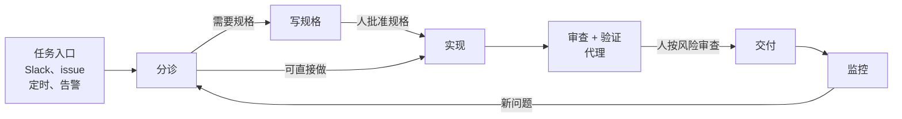

# 第 9 章　软件工厂

**中文** | [English](../en/09-the-software-factory.md)

## 本章对应的原始材料

| 类型 | 日期 / 讲者 | 内容 | 官方链接 |
|---|---|---|---|
| 讲座 | 11/17 · Mihail Eric | 软件工厂与自改进的软件系统 | [课件](https://docs.google.com/presentation/d/1hxlLspHQ2WOs2tZmCN3gdDi7dfbbRorxzPr65HyyE6Y/edit) |
| 嘉宾 | 11/19 · Michele Catasta（Replit 总裁） | 嘉宾讲座 | 官网暂未发布材料 |
| 阅读 | Warp | From Issue to Pull Request: A Warp Factory Example | [GitHub](https://github.com/warpdotdev/warp-factory-examples/tree/main/examples/02-sdlc-issue-to-pr) |
| 阅读 | Ona | The Software Factory | [software-factory.dev](https://software-factory.dev) |
| 阅读 | — | OpenInspect | [openinspect.dev](https://openinspect.dev) |
| 阅读 | Zach Lloyd（Warp） | WarpBench: Evaluating Coding Agents | [Warp](https://warp.dev/factories/benchmarks/warpbench) |
| 课件引用 | Zach Lloyd | Adopting the software factory model: crawl, walk, run | [Warp Blog](https://www.warp.dev/blog/adopting-the-software-factory-model-crawl-walk-run) |
| 课件引用 | Eric Zakariasson（Cursor） | Building your own software factory（AIE Europe 2026） | [YouTube](https://www.youtube.com/watch?v=rnDm57Py54A) |
| 课件引用 | Zach Lloyd | How to Build a Software Factory That Improves Itself | [YouTube](https://www.youtube.com/watch?v=nKjPBAw_N_0) |
| 按周笔记 | 第 9 周 | 原始笔记 | [附录：第 9 周笔记](../../weeks/week09/zh/notes.md) |

> [!NOTE]
> **补充**
> 官网课表在开课后做过调整：第 9 周原定是「打造 AI 原生团队」，现在是「软件工厂」，AI 原生团队移到了第 10 周。本章按当前课表编写。

## 本章学习目标

1. 说清软件工厂的三个组成部分：生产线、质检、反馈循环，以及它和第 8 章单个后台代理的区别；
2. 能画出一个软件工厂的结构，指出人守的三道关和两条回路；
3. 理解「工厂定义写成代码」的意义，能读懂一份工厂配置；
4. 知道怎么用评审员和私有基准判断工厂在变好，该看哪些指标；
5. 知道部署之后的监控和安全为什么是工厂里最容易被低估的部分，以及一个团队该怎样分阶段采用。

## 9.1 从一条流水线到一座工厂

第 8 章的后台代理接一类任务、交回一个 PR，相当于一条流水线。真实的软件开发不止写代码：有人报了一个 bug，要先弄清楚能不能复现；需求含糊，要先写规格；代码写完要审查、要验证、要发布；上线之后还要盯着，出了问题再回到开头。

把这些环节全部交给代理，再让整套系统从自己的失败里学习，就是课件说的软件工厂。课件给的理由是，编程代理已经强到可以让人退后一步：

> "we're moving toward a world of orchestrating software tasks with humans on the loop rather than in the loop"
> 我们正在走向这样一个世界：编排软件任务时，人站在回路之上，而不是身处回路之中。
> —— 第 17 讲课件（11/17）

「在回路之中」是人亲手完成其中一步，比如自己写代码；「在回路之上」是人设计和监督这个回路，只在关键节点拍板。课件还补了一句：大多数软件工作的形式相对固定，所以把它们自动化是顺理成章的下一步。

课件把软件工厂拆成三个部分：

| 部分 | 做什么 |
|---|---|
| 生产线 | 一组云端后台代理，从任务的来源接活（issue、Slack 线程、Sentry 告警、定时任务），在隔离环境里完成，交回 PR |
| 质检 | CI、静态分析、测试和 AI 审查员，用同一个标准检查每份产出，不管是谁或什么发起的 |
| 反馈循环 | 有缺陷漏过去时，记下原因，把它变成一份文档、一个 skill、一条 lint 规则或一个工具，让缺陷率随时间下降 |

前两部分在第 6 章和第 8 章都见过。第三部分是新的，也是「自改进」这个说法的来源。

## 9.2 先决条件：代理要能自己跑起来

课件列了建工厂的三个前提：工具访问、隔离的控制面、代理就绪度。代理就绪度这一条引用了 Cursor 的 Eric Zakariasson 在 AIE Europe 2026 的演讲，拆成三个问题：

1. **能跑起来吗？** 代理能不能在没有任何人参与的情况下启动你的开发环境？能的话，就可以在独立的虚拟机上横向扩展；
2. **能拿到吗？** 代理能不能接触到任务需要的外部上下文和工具？
3. **能验证吗？** 它能不能验证自己的改动？

这三个问题和第 5 章「让代码库适合代理」一脉相承。区别在于，第 5 章是为了让你身边的代理少出错，这里是为了让成百上千个无人看管的代理能同时干活。只要其中一条做不到，比如启动开发环境需要某个人手动输一次密码，工厂就建不起来。讲师在 11/20 的一条 X 帖子里把这一点总结为「代理就绪是第一位的」。

## 9.3 工厂的结构

课件用 Zach Lloyd（Warp CEO）的一张图讲工厂的结构。下面是我们按课件文字说明重画的简图：

读这张图要抓住三点。

**第一，每个代理只做一件事。** 分诊代理判断任务能不能自动化：能就直接交给实现代理；范围或含义不清的，交给规格代理先写规格；实在太模糊，就找人补充信息，或者先搁置。实现代理写代码，审查代理审查，验证代理用计算机操作（像人一样点开页面看）或其他方式检查结果。每个代理在自己的隔离沙箱里运行。

**第二，人守三道关。** 批准规格、按风险分级的代码审查、产品层面的检查。人不再出现在每一步，但在这三处必须出现。

**第三，有两条回路。** 一条是监控代理发现问题后建 issue，送回分诊，形成闭环。另一条更进一步：工厂的遥测数据（每个 PR 的成本、周期、人工介入次数）交给观察代理，由它们给工厂本身的定义提 PR，人审核后合并。第二条回路就是 9.1 节说的反馈循环，工厂在改进自己。

Zach Lloyd 在给 Warp 团队的内部备忘录里写到，每次需要人介入，平台都应该记下来，让负责自我改进的代理设法调整流程，降低下次再需要人介入的可能。

## 9.4 把工厂写成代码

工厂里有很多代理、很多规则、很多触发条件，靠在网页上点选配置很快就管不住了。课件对比了两种搭法：

- **拼装式**：把现有的工具拼起来，比如某个 Claude 自动化负责审查、Devin 负责修 bug；
- **基础设施即代码**：像用 Terraform 管云资源一样，把整个工厂定义写成仓库里的文件，可以 diff、审查、回滚。

后一种的好处在第 9.5 节会更清楚：配置有了版本，才能比较「改之前」和「改之后」哪个更好。

本周阅读里的 Warp 示例就是一份写成代码的工厂。它的目录大致是这样的：

| 目录 | 内容 |
|---|---|
| `agents/` | 五个默认代理 FOREMAN（总调度）、TRIAGE、SPEC、IMPLEMENT、REVIEW，加一个处理移动端构建的自定义代理；每个代理一份 `agent.md` |
| `automations/` | 触发条件：Slack 被 @、Slack 私信、Linear 会话、GitHub 被 @ 或被指派、PR 关闭或合并后的收尾 |
| `runners/` | 运行环境：4 核 8 GB 的 Linux 给读代码写文字的阶段，8 核 16 GB 给编译和测试，macOS 给移动端 |
| `scorers/` | 评分器：一个给实现运行打分并开启自我改进，一个给审查运行打分 |
| `skills/` | 所有代理共享的仓库约定；某个代理专用的 skill 放在它自己的目录下 |

有几个细节值得注意：

- **审查代理和实现代理用不同的模型**，减少共同的盲点。这和第 6 章「审查要换模型」的建议一致；
- **按阶段分配算力**：只读代码和写文字的阶段不需要大机器，编译和测试才需要；
- **触发条件要收紧**：GitHub 入口要求「被 @ 或被指派」和「带有工厂的路由标签」同时满足才启动。示例专门提醒，去掉标签条件，任何 @ 都会启动工作；再去掉 @ 条件，有人被提到就会触发。对一座会自己写代码的工厂来说，入口过宽既浪费钱，也是安全问题。

## 9.5 质检：评审员和私有基准

工厂要能自我改进，先得能判断「好」和「不好」。课件给了两个工具。

**评审员给每次运行打分。** 用大模型对照规格给整次运行打分，而不是凭感觉。第 8 章讲过 Spotify 的评审员：对照原始提示词检查 diff，否决约四分之一的会话。Zach Lloyd 的演示里还有一个评分器，专门抓代理写了多余的测试。评审员可以有很多个，各管一个维度。

**用自己的历史做基准。** 公开基准有两个问题：任务和你的工作关系不大；题目可能已经混进了模型的训练数据。更可靠的做法是重放自己过去的任务。WarpBench 就是这样做的：

1. 让总调度代理从过去的代理运行里挑出 30 个有代表性的任务，按 S、M、L、XL 分级，覆盖服务端和客户端；
2. 用 git 恢复当时的代码，以及当时的工厂配置，保证代理定义和 skills 前后一致；
3. 在原始环境里重放，换不同的模型，用评审员按成本、质量等维度打分。

一次完整跑下来用了 3 小时 46 分钟、2,130.57 美元。所以文章建议不要频繁跑，只在新模型发布或代码、skills、MCP 有大改时跑。根据结果换了默认实现模型之后，Warp 说内部每个完成的 PR 成本从约 80 美元降到约 30 美元，合并率没变，任务合规分从 69% 升到 87%。

> [!NOTE]
> **补充**
> 这些数字是 Warp 自己报告的。课件特别提醒：Zach Lloyd 在不同场合给出的每 PR 成本数字不完全一致，应当只看成本下降的趋势。另外要注意，第 2 步之所以能做，是因为工厂定义写成了代码（9.4 节）。如果配置散落在各个网页后台，就没法把「当时的工厂」原样恢复出来。

## 9.6 自我改进：每次失败都让系统变好

反馈循环说起来简单：缺陷漏过去，就记下原因，变成文档、skill、lint 规则或工具。难的是坚持把每一次失败都当作改进系统的机会，而不是顺手修掉这一个 bug。

课件里有一句话说得很清楚：代理跑偏是改进工厂的信号。人在回路上的工作，主要就是这件事。讲师在 11/20 的 X 帖子里把它列为工厂的核心原则之一。

Ona 的公开实验给了一个具体例子。他们在十天里用代理做一个类 Notion 的笔记应用，第 5 天公司 COO 压测后报了 12 个 bug。工厂其实一直在修 bug，但修的不是同一批：接入了 Sentry 的运行时错误，工厂能自己发现、自己修；视觉和交互上的问题，还得靠人指出来。他们在直播里展示了用一个 `quality.md` 文件做自我改进的循环，并当场新建 bug 看工厂怎么处理。

这个例子说明，反馈循环能覆盖多少，取决于系统能「看见」多少。看不见的那一类问题，就需要人来补，或者想办法让它变得可见。

## 9.7 部署之后：监控和安全

本周大纲的第三个主题是「部署后运行代理并保障安全」。这部分最容易被低估。Ona 实验结束时的一条主要体会是：工厂的运维那一侧需要的自动化，比构建那一侧更多。

部署之后有三件事：

- **监控回路**：监控代理发现问题就建 issue，送回分诊（9.3 节的第一条回路）。课件列出的适合放进工厂的任务里，就有生产事故的初步调查和安全漏洞；
- **按风险分级**：低风险的改动可以自动批准，高风险的交给人。课件明确说，安全、数据和支付由人负责；
- **能停下来**：本周嘉宾、Replit 总裁 Michele Catasta 在 11 月初的一条 X 帖子里引用调查说，86% 的受访组织在运行代理，但能自动叫停一个行为失常的代理的不到 18%。他的结论是，托管、隔离的云端代理应该成为自主开发的默认做法。

Replit 的博客把这种受控的运行环境叫作「代理栖息地」（Agent Habitat）：控制访问权限，规定什么时候必须有人批准，限制错误的影响范围；有人纠正了代理，这个纠正经审核后应该能改进以后的工作。这和 9.6 节的反馈循环是同一个思路，只是从代码扩展到了整个公司。

## 9.8 人的角色和工厂的指标

工厂建起来以后，人做什么？课件给了四条：

1. **从工人变成管理者**：同步做计划，异步做执行；
2. **按风险分配审查**：安全、数据和支付由人负责；
3. **把代理跑偏当成改进工厂的信号**；
4. **发布出去的东西仍由人负责。**

衡量工厂看的是每一个交付的改动付出了多少，而不是产出了多少：

| 指标 | 含义 |
|---|---|
| 每个 PR 的成本 | 模型、算力加起来，交付一个改动花多少钱 |
| 周期 | 从任务进来到合并用了多久 |
| 每个 PR 的人工介入次数 | 人在中间插手了几次，越少说明工厂越成熟 |
| 经过工厂的比例 | 合并的 PR 里有多少是工厂产出的 |

课件特别说明不看代码行数，也不看 token 数。这两个数字很容易涨，但和交付的价值关系不大。

Ona 实验第十天公布的数字可以作为参照：十天合并 375 个 PR、5 万多行代码、16 个自动化、1,067 个测试、自主率 87%、PR 到合并的中位时间 4.9 分钟。他们的总结是：

> "You don't build Memo, you build a factory to build Memo."
> 你不是在做 Memo，而是在做一座生产 Memo 的工厂。
> —— Ona，The Software Factory 第 10 天

## 9.9 怎么开始：爬、走、跑

一下子建一整座工厂不现实。课件引用 Zach Lloyd 的「爬、走、跑」三阶段：

1. **爬**：先把单点自动化用在杂活上，比如分诊新 issue、自动审查 PR、响应 Sentry 告警修 bug、修复挂掉的 CI。选测试完善、结构标准的仓库。这一步风险低，主要是积累对代理的直觉；
2. **走**：在一个简单的产品面上跑通一个端到端的工厂，比如营销网站或内部工具。Warp 的营销网站约 75% 的改动由这样的工厂完成，人只需在 Slack 或任务系统里描述想要的改动；
3. **跑**：基础回路跑稳了，再扩到复杂的仓库。这时远程开发环境、成本、安全审计、多人协作都会成为新的瓶颈。

采用时还有三条建议：去人已经在用的地方（Slack、Linear、GitHub），不要另开一个门户；鼓励使用，但不强制；用风险分级决定哪些改动仍需要人审查。

Zach Lloyd 认为单点自动化迟早会遇到天花板：各自的上下文不共享，审查环节的改进带不到分诊和验证；也没有全局的指标看整体效率是否在提升。这正是从「爬」走到「走」的理由。

## 嘉宾专栏：Michele Catasta（Replit 总裁，11/19）

> [!NOTE]
> **补充**
> 这一讲官网暂未发布材料和录像。讲师的预告说，Replit 自称「自动驾驶公司」，预测到 2030 年每家财富 500 强公司都会是这样；Replit 的工程师在 2026 年上半年代码产出接近翻了三倍，审查时间、回滚和事故数则保持不变。
>
> 背景材料可以看 Replit 的博客 [The Rise of the Self-Driving Company](https://replit.com/blog/rise-of-self-driving-company)（Amjad Masad 撰写）：人设定目标、做判断、承担责任，代理在明确的边界内执行，边界由 9.7 节说的「代理栖息地」来保证。讲座前两天（11/17），Replit 发布了让多个代理协作完成一个目标的 Missions，用户在协议里设定花费上限和哪些操作需要批准。Catasta 本人和本章主题最接近的公开演讲是 [The 3 Pillars of Autonomy](https://www.youtube.com/watch?v=MLhAA9yguwM)（AI Engineer，2025-12）和 [Evaluating and improving Replit Agent at scale](https://www.youtube.com/watch?v=snroDwX1-JU)（2026-05，讲 Replit 怎么评估和改进自己的代理）。材料公开后补充。

## 相关视频

- [Building your own software factory — Eric Zakariasson, Cursor](https://www.youtube.com/watch?v=rnDm57Py54A)：课件引用，9.2 节「能跑起来、能拿到、能验证」的出处。
- [How to Build a Software Factory That Improves Itself — Zach Lloyd](https://www.youtube.com/watch?v=nKjPBAw_N_0)：课件引用，讲评分器和私有基准。
- [Software Factory in Public: 375 PRs in 10 Days](https://www.youtube.com/watch?v=a4pEznCiWNo)：Ona 实验的总结。
- 完整列表见 [视频资源汇总](../../VIDEOS.md)。

## 动手练习

1. 克隆 Warp 的 `warp-factory-examples`，读 `02-sdlc-issue-to-pr`，画出一个 GitHub issue 从进来到出 PR 会经过哪些文件里定义的哪些代理；
2. 按 9.2 节的三个问题检查你自己的项目：有哪一步需要人手动操作才能启动开发环境？
3. 从你过去的 PR 里挑 10 个，按大小分级，写成一个小基准；换两个模型各跑一遍，记录成本和你给的质量分；
4. 为你最常遇到的一类代理失误写一条 lint 规则或一个 skill，并记下它之后是否再次出现；
5. 选一个低风险的杂活（比如给新 issue 打标签），按「爬」的阶段把它自动化。

## 自查

- [ ] 能说出软件工厂的三个部分，以及「自改进」来自哪一部分
- [ ] 能画出工厂的结构，指出人守的三道关和两条回路
- [ ] 能解释为什么工厂定义要写成代码
- [ ] 能说出私有基准比公开基准好在哪里，以及 WarpBench 的做法
- [ ] 能说出工厂该看的指标，以及为什么不看代码行数和 token 数
- [ ] 能说出「爬、走、跑」各阶段要做什么

## 下一章预告

工厂建好之后，问题就从「怎么让代理干活」变成「一个组织怎么管这么多代理」。第 10 章将在 12/1 的课后更新，按官网目前的课表，内容是 AI 原生团队（MCP 门户、大模型网关、模型路由与成本优化、组织层面的采用）和软件品味。
